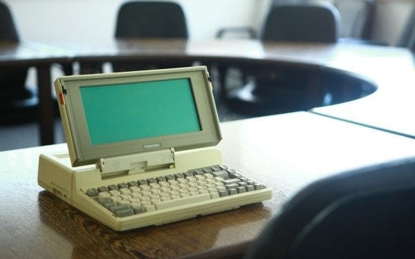
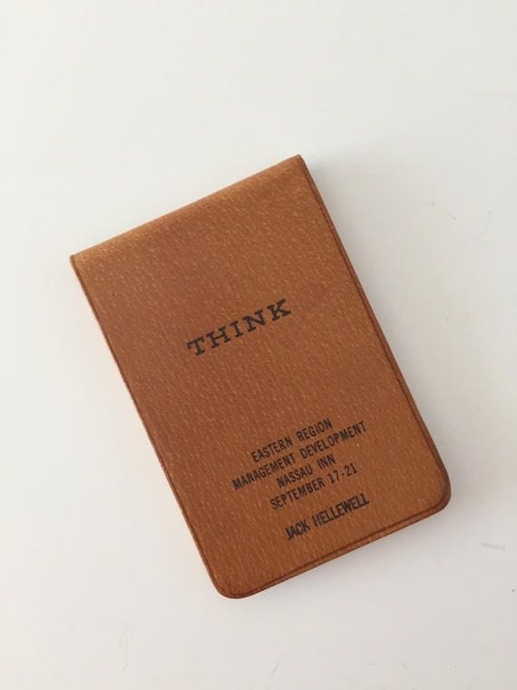
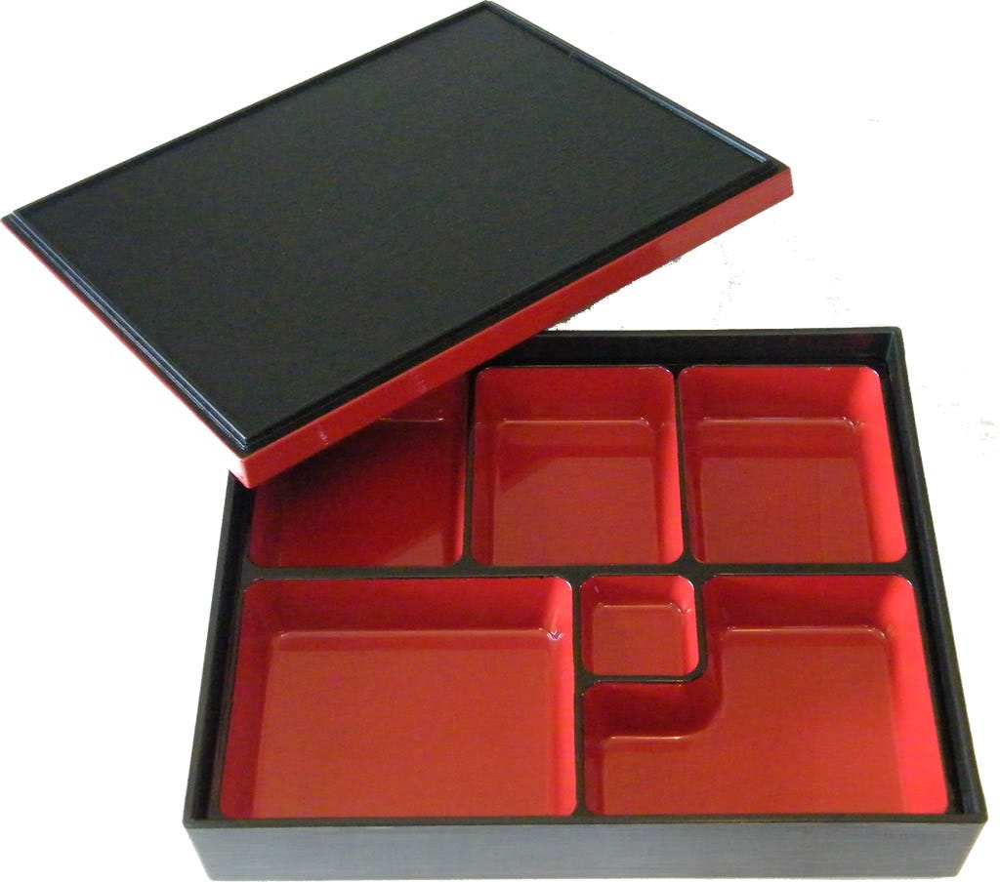
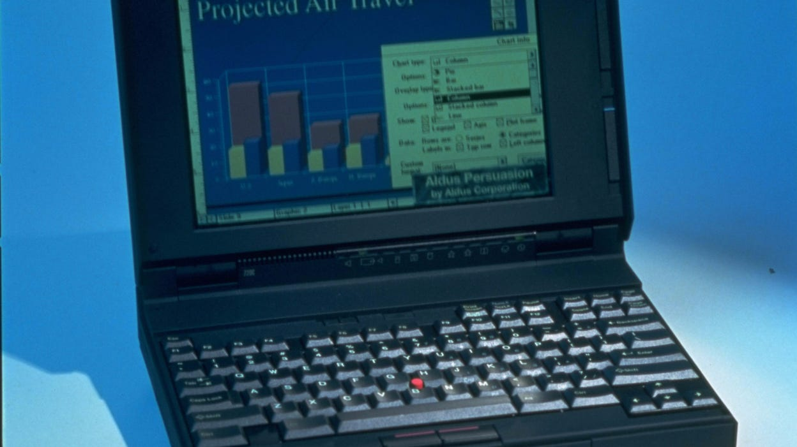
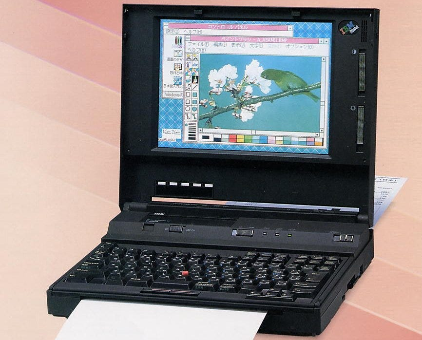
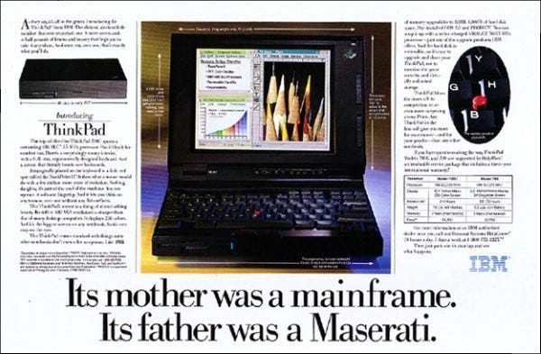
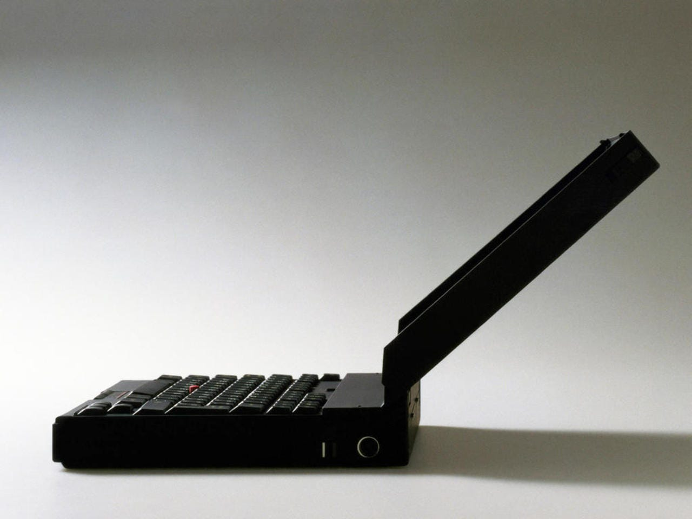
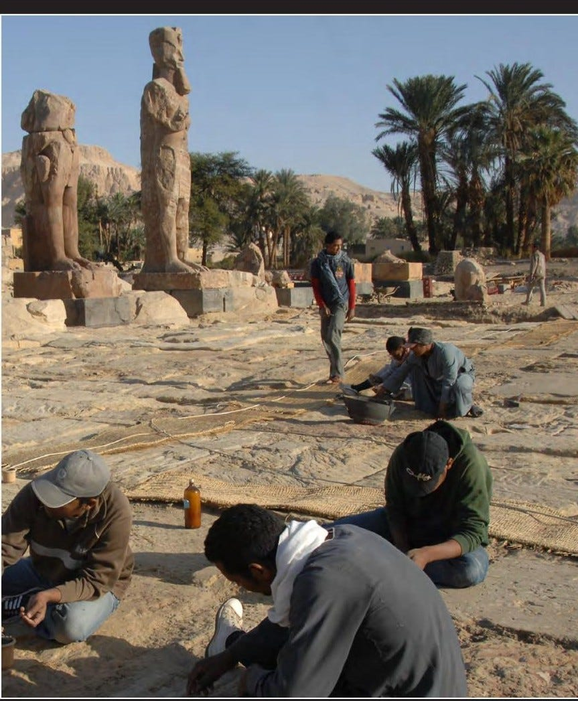
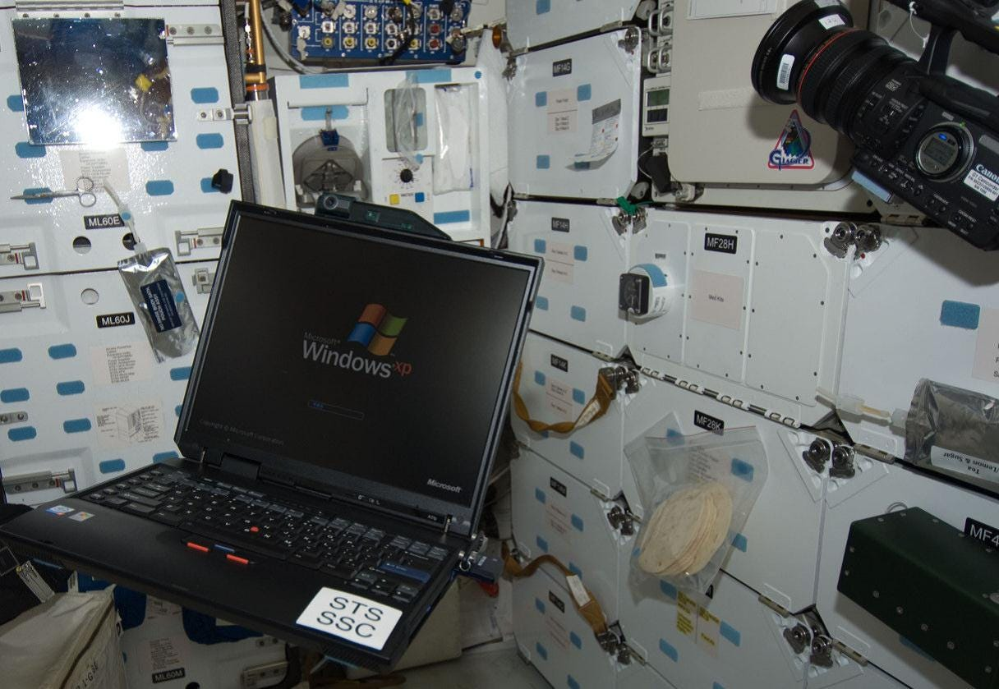

Birazcık da bu efsaneyi medium üzerinden övelim…

90'ların başı bilgisayar tarihi için oldukça önemli bir mihenk taşıdır. Artık eski tarzda düşük bellekli ve oldukça basit işleri yapabilecek 16 bitlik işlemciler, İntel’in 80386 kodlu 32 bit işlemcilerine yerini bırakmış ve bu da yeni ve daha güçlü bilgisayarların oluşturulmasına fırsat sağlamıştı. Commodore, ZX gibi efsaneleşmiş markalar bir bir güncelliklerini yitirmeye başlarken Apple gibi markalar daha güçlü bilgisayarlar geliştirmeye başlamıştı.

Ayrıca yine 90'larda depolama teknolojileri de değişiyordu. İnteraktif Kompakt Disk olarak bilinen CD-i yavaş yavaş endüstriyel hayata girmişti. Microsoft Office uygulamaları da yine 90ların başında satışa sürüldü. Sonuç olarak insanlar eski tarz düşük bellekli ve sınırlı işlem kaabiliyeti olan cihazlardan yüzlerini farklı bir tarafa döndürmeye başladı.

Bu dönemde aslında piyasa iki uçtan farklı şirketler tarafından ele geçirilmişti. Bir tarafta Motorola’nın güçlü işlemcileri ile donatılmış Machintosh cihazlar yüksek fiyatları ile endüstri tarafına hitap ederken bir diğer uçta daha ucuz yollu Compaq cihazlar son kullanıcı ile buluşmuştu.

Harvard Üniversitesinde ise farklı bir ihtiyaç oluşmuştu. Hiç işletme okuyan tanıdığınız var mı bilmem (benim var) ama bu insanlar günlerinin büyük bölümünü satırlar sutünlar çizip bunları hesaplayarak geçirirler 😂 Gözlemlerime göre bölümde ilk senelerinin ilk dönemlerinde kağıt üzerine bir sürü satır ve sutünlar ile onlarca veriyi elle giriyorlar (çoğunlukla frekans tabloları oluşturup sonrasında sadeleştirilmiş bu tabloları yansıtıyorlar) ve bu hesaplamaları basit bir hesap makinesi ile grafiklere veya tablolara döküyorlar. Sonraki senelerde ise elle yapılan bu zulüm dolu işlem hesaplarını, bilgisayarda Excel kullanarak yapıyorlar. İşte dikkatimi çeken şey bu bilgisayar serisinin yaratılmasının sebebi de işletmeciler. 90'ların başında Harvard’da okuyan öğrenciler oldukça uzun ve yorucu olan bu elle hesaplama yöntemlerini bilgisayar kullanarak hesaplamayı akıl etmişlerdi.

Aslında bu tip hesaplamalar için bilgisayarın kullanılması yeni bir konsept değil. Neredeyse 70'lerden beri tablo hesaplama uygulamaları kullanılmakta. VisiCalc ve halefi olan Lotus, özellikle borsacılar ve istatistik bilimi ile uğraşanlar için başucu yazılımı haline gelmişti. Saatler süren hesaplama cetvellerini bir program yardımı ile oldukça basit bir şekilde yeniden ifade etmek, işlem hatalarından kurtulmak için oldukça iyi bir çözüm sonuçta. Harvard öğretmenleri ve öğrencileri de bu amaçla kullanabilecekleri ancak daha portatif cihazlara sahip olma fikri ile çeşitli çözümler arayışına girmişlerdi. Bu alanda çözüm olarak piyasaya efsanevi Toshiba 1100 çıkmıştı

Bu bilgisayar tarihinin ilk taşınabilir bilgisayarı idi. 1985'de çıkan bu bilgisayar siyah-beyaz bir ekran paneli ve bu ekranın üzerine katlanabileceği entegre klavye ile gelen hayli sade bir bilgisayar modelidir. Daha çok taşınabilir bir bilgisayar modeli de diyebiliriz

Harvard öğrencileri de bu hayli taşınabilir olan bilgisayarı tablo hesaplamaları için kullanmaya başlamışlardı. Pazarın bu denli dinamik olduğu bir alanda çözüm üretmek bir şirkete kısa sürede kar, uzun vadede ise yayılabilecek alan açmaya yarar. Apple için 2000lerin ortasında telefon üzerine çalışmak neyse IBM için de 90'larda bilgisayar işi o denli önem arz eder bir konumdaydı. Daha öncesinde güçlü işlem üniteleri ile endüstride oldukça sağlam bir konuma gelmiş olan IBM 90'ların başında bilgisayar üretimi alanına da girmek istedi. İşte film tam da orada koptu denilebilir.

Ortada güzel bir pazar var, ayrıca bir sorun var. Bu sorun için halihazırda geliştirilmiş bir çözüm de var. IBM aslında tam da bu aşamada geliştirilmiş çözümü daha güzel bir paketle sunmayı amaçladı. Diğer sistemlerin aksine oldukça sade bir görünüme sahip, dayanıklı ve güçlü bir sistemi taşınabilir bir pakete sığdırmayı hedef olarak ortaya koydu. Bu planlarını da IBM’in ünlü “Düşün” (Think) kapaklı defterleri ile tasarım ekibine yolladı.

IBM’in ünlü defterlerinden birisi

Bu planlar üzerine çalışacak ekip IBM’nin kişisel bilgisayar misyonunda çalışan bir ekipti. Unutmadan söylememiz gerekmekte, IBM Thinkpad’den önce herkes için bilgisayar mottosu ile kişisel bilgisayar üretimi için hayli bütçe, zaman ve insan ayırmış bir şirket. Bu şirketin kişisel bilgisayar geliştirme ekibinin başında da IBM’in ünlü mühendisi (şu anda Lenovo’da sorumlu olan) **_Naito Arimasa_**  vardı. Ayrıca bu projenin yetkililerinden birisi ise hiç yabancı bir isim değil. Kendisi eskide Compaq markası altında yine taşınabilir bilgisayarlar alanında çalışmış, 12 senedir de yine IBM çatısı altında bu alanda lojistik müdürlüğü yapmış olan Tim Cook. Şimdi daha çok “şu ısırılmış marka”nın CEO’su olarak tanınıyor.

Neyse artık, sonuç olarak sağlam bir ekip ilk tasarımlara başladı. Tasarım olarak yenilikçi ve basit bir tasarım planlandı. Ekibin başı Arimasa, bu cihaz için Japonların yemek kapları olan _bento_dan ilham alarak bir tasarım yaptı.

Bu tasarım önceki taşınabilir bilgisayar modellerini aksine daha keskin ve kutu gibi hatlara sahipti. Tasarımı ile müstesna. Ayrıca farklı fikirleri de beraberinde tasarlamışlardı. Örneğin CD okuyucusu için uygun bir yer bırakılmış ve Media cihazı olarak da ThinkPad’in kullanılabileceği bir alan bırakılmıştı. Ayrıca toplu farelere alternatif niteliğinde olan tarihin ilk laptop faresi sayılabilecek ve hala da ThinkPad’lerin imzası niteliğinde olan TrackPoint de ilk modelde fare alternatifi işaretçi olarak kullanılmak üzere ortaya atıldı. İlk tasarımı ile oldukça sade ve taşınabilir özellikte bir bilgisayar çıkartılmış olundu.

İlk ThinkPad üzerinde çalışan bir grafik uygulaması

Ayrıca ilk tasarımının dallanmış modelleri farklı amaçlarla kullanılabilecek ek modülleri de içeriyordu. Örneğin tasarlanan ve bir süre Japonya’da da satılan faks makinesi ve çıktı aygıtı da içeren modelleri de yine tasarımın ilk dönemlerinde planlandı.

Japonyada 1993–1995 aralığında satılan bir ThinkPad modeli. Beraberinde Canon’un oldukça başarılı bir çıktı veren modülünü de getiriyordu.

Bütün bu planların tamamı üzerinde “Düşün” yazan not defterleri ile birimler arasında gidip geliyordu. IBM bu cihaz için tüm hazırlıklarını tamamlamıştı. 1991'de ilk prototip başarı ile test edildikten sonra bu cihazlar için model isimlendirilmesi yapıldı. Bu seriye 700 kodu verilecekti. İlk olarak piyasaya IBM 700 ve IBM 700C sürülecek ardından 700T olarak adlandırılan bir tablet modeli de ürün gamına eklenecekti (evet bir tablet modeli).

Ancak işte o dönemde isimlendirme üzerine bir tartışma oldu. IBM’nin mühendislerinden Denny Wainwright üzerinde “Düşün” yazan bu defterlerden esinlenerek modele “ThinkPad” (“Think”= Düşün, “Pad”=Notepad yani defterden kökenini alacak şekilde) ismi verilmesi için tavsiyede bulundu. Bütün ekip için oldukça parlak bir fikir olarak görünen bu şey IBM tarafında pek iyi karşılanmadı denilebilir. IBM yöneticileri o döneme kadar piyasadaki bütün modellere sadece sayısal model isimleri verilmesi sebebiyle karşı çıksalar da bir yerde “Hele böyle çıksın sonra nasıl olsa sayısala geri döner” diyerek bu fikre onay verdi. Ve IBM ThinkPad bir anda piyasaya bomba gibi düştü.

“Annesi bir bilgisayardı. Babası da bir Maserati” başlıklı ThinkPad haberi. Bilinen ilk ThinkPad reklamı denebilir.

Taşınabilir oluşu, sonraki modeli olan 770 ile beraber gelecek olan CD okuyuculu modeli ile kısa sürede bir tarafta öğrencileri, diğer tarafta iş dünyasını ve hepsinden önemlisi ise endüstriyi kasıp kavurdu. Bu işin bazı önemli kopuş noktaları var.

ThinkPad sadece tasarımı ile doğru noktada doğru bir tasarım yapması ile değil pazarlama stratejisi ile, kalitesi ile ve tabiki teknolojiyi yeniden yorulması sayesinde oldukça sağlam bir konuma kendisini getirdi. İlk olarak kullanılabilirlik tarafı. ThinkPad tek parça halinde bir bilgisayar olmayı başarmış ilk bilgisayardır diyebiliriz. Commodore gibi cihazların aksine kendi ekranına sahip, Machintosh gibi ek bir işaretçi cihazına gerek duymadan TrackPoint ile farenin işlerini yapacak bir işaretçiye sahipti. Ayrıca bütüm bu paket küçücük bir kasa içerisinde açılır kapanır bir panel ile sunulmuştu.

Tasarımının sadeliği ve ürettiği çözümler bakımından ThinkPad zamanın ötesinde bir tasarıma ve kullanışlılığa sahipti. Nitekim çıktığı sene ve sonrasındaki senelerde 300'den fazla tasarım ve kalite ödülüne sahip olması da şaşırtıcı olmadı.

İkinci ve en önemli olarak ThinkPad’ler sağlam bir pazarlama politikası sayesinde pazarda çok kısa sürede kendine yer buldu. IBM, ThinkPad’i erken müşteri pilot programları, lansman öncesi yaptığı tamamen “brief” diyebileceğimiz duyuruları ile sorun-çözüm ilişkilerini oldukça iyi bir tanıtım yaptı. Ayrıca kapsamlı bir ödünç verme programı ile bu bilgisayara ihtiyaç duyan ve önemli işler yapan pek çok kişinin projesinde ThinkPad’i kullanmasına olanak sağladı. Burada arkeolojiden tutun uzay çalışmalarına kadar geniş bir alandan bahsediyorum. IBM ilk olarak Mısır’da Leontopolis antik kenti kazılarında yer alan arkelog ekibe ThinkPad sağladı. Ardından içlerinde IBM Japonya’nın Yamoto Labotuvarlarının da görev aldığı İtalya-Japonya yüksek kaliteli telefon aktarımı projesi için IBM finansman olarak bu bilgisayarları ortaya koydu. Sonuç olarak ThinkPad en zorlo koşullardan, teknolojinin en uç noktalarına kadar her yerde kullanılabileceğine dair rüştünü daha doğar doğmaz kanıtlamış oldu.

Mısırda bir kazı- Tamamen görsel amaçlı

Oldukça sağlam ve kaliteli bir ürün olarak, güzel bir reklam politikası ile ortaya çıkan ThinkPad 2000'lerin başına kadar her alanda bilgisayar dünyasını domine etti ve pek çok model için mihenk taşı oldu. Pek çok halefi en temelde onun sade tasarımını hedef alarak geliştirildi.

Ancak hepsinden önce ThinkPad ailesi her zaman teknolojiyi en uçta insanların önüne sunan firma oldu. En basitinden 2020 sonunda çıkan dünyanın ilk gerçekten fonksiyonel olarak nitelendirilebilecek katlanabilir ekranlı bilgisayarı yine ThinkPad ailesi altında çıktı. Windows 11 ile adını sıkça duyduğumuz TPM modülü yine ThinkPad ailesi ile bilgisayar dünyasına girdi. Yine TPM gibi ThinkShutter gizlilik kapağı ile kamera gizliliği konusunda ThinkPad kendi patentini ortaya attı. Ayrıca, 2004 yılında parmak izi modülünü getirerek parmak izi ile sistem açma özelliğini getiren ilk bilgisayar da bir ThinkPad oldu. Yani ThinkPad sadece bir ürün gibi değil bir teknoloji olarak görüldü ve geliştirildi desem yeridir.

Buraya kadar söylediklerim benim ThinkPad’i sevmemden dolayı yağdırdığım övgüler olarak görülebilir. Ama doğrudur 😂. Yani arkadaşlar NASA bile 1998 2015 arasında sadece ThinkPad kullandıysa uzayda bir bildiği vardır.

STS modülü içinde bir ThinkPad bilgisayar

Hepsi bir yana geriye kalan hikayeyi az çok biliyorsunuzdur.

2005 yılında Lenovo IBM ile başta ortaklığa girişti sonrasında ise ThinkPad ürün hakkı ile IBM Kişisel Bilgisayar misyonunu kendi adı altına aldı. Ancak son 30 küsür senelik yaşamı boyunca ThinkPad hep aynı değerlerini kullandı. Teknoloji ile bu özelliklerini harmanladı. Tasarım olarak sade, oldukça sağlam ve kullanıcı dostu bir ortam olmayı başardı.

Bugün ben bu yazıyı bir ThinkPad ile yazıyorum. Belki bu yazım sizlere biraz fanboy yazısı gibi gelebilir ancak bildiğim tek bir şey var, bu bilgisayar gerçek manada üzerine çalışılmış, bir ekmek gibi yavaş yavaş pişirilip olgunlaşmış, oldukça tok bir bilgisayar ailesi. Gerek ince detayları, gerekse teknolojisi ile aynı fiyatta sadece RGB olduğu için ve içerisinde sözde oyun ismi geçtiği için satılan pek çok dandirik bilgisayarla karşılaştırınca aradaki kalite farkı daha çok ortaya çıkıyor.

Aslında takdir edilmesi gereken bir proje ThinkPad. Çıktığı ilk günden beri her daim ilk günki çizgisini hiç bozmadan, kendisini teknolojiye gerek adapte ederek gerekse teknolojiye öncü olarak konumlandırarak ben başta olmak üzere dünyada pek çok kalbi çaldı, pek çok kullanıcıya güzel bir deneyim sunmayı başardı.
