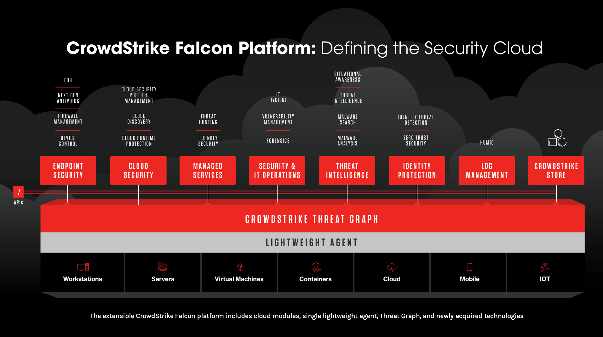
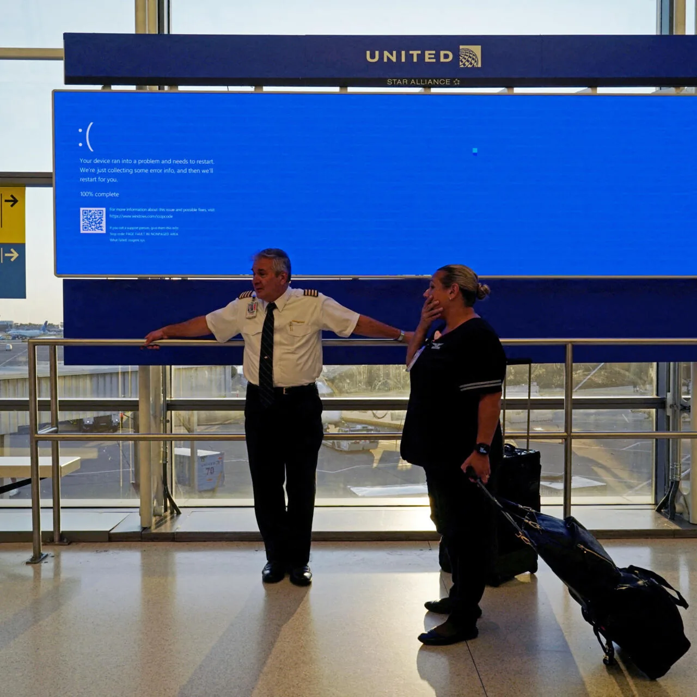

Her gün, her seferinde işletim sistemlerimize uzun bir liste dolusu çoğunu kullanmayacağımız özelliklerin oluşturduğu güncellemelerden bir yenisi ile uğraşıyoruz. Bilgisayarınızın sağ altında beliren veya bilgisayarınızı kapatmaya çalışırken sarı bir nokta ile ben buradayım diyen bu güncelleştirmelerden bir tanesi 19 Temmuzda yani dün bir felakete yol açtı. Peki neden bu felaketi yaşadık? Yoksa bu da büyük bir başka felaketin habercisi mi?

Giriş
----

Konuya CrowdStrike'ı anlatarak giriş yapmak istiyorum. Kendisi siber güvenlik konusunda adı geçen ve kurumsal olarak büyük çapta hizmet veren bir firmadır. Öyle "Ne var ki canım Norton var, McAffee var biz hiç bu arkadaşların ismini duymadık" demeyin adama gülerler. Ancak kabul etmek gerekir ki çok isimlerini ben bile duymadım, aylar öncesinde TrendMicro'ya dair bir sayfada gezinirken karşıma çıkmıştı yani bir nevi kendilerinin rakibini araştırırken duymuştum ve fiyat olarak tuzlu olduğunu görünce haydi ben kaçar diyip kafamın derin delhizlerine kendisini atmıştım. Lakin kendileri Amerika'da hatrı bayaa sayılan bir şirket.  

CrowdStrike Sony'nin hacklenmesi olayında (2015 Kuzey Kore'nin Sony Saldırısı) FBI için tabiri caizse [bilirkişilik yapmış](https://www.pcworld.com/article/431927/whats-in-a-typo-more-evidence-tying-north-korea-to-the-sony-hack.html), Çin menşeili pek çok siber saldırı ile alakalı ABD yargı makamları için hatta başkanlık seviyesinde [raporlar hazırlamış](https://www.wsj.com/articles/report-warns-of-chinese-hacking-1445227440) ve bu raporları ciddiye alınmış bir şirket. 

Eee, hatrı sayılan bu şirketin de kabarık bir kullanıcı listesi var ki bu olay sırasında sadece Amerika'da, Fortune 500 şirketlerinin yaklaşık üçte ikisi ve Fortune 1000 şirketlerinin yarısından fazlası kesinti yaşadı [🔗](https://www.newsweek.com/crowdstrike-outage-banks-apps-impacted-1927642). Dünya genelinde ise Microsoft'un açıklamasına göre 8.6 milyondan fazla Windows yüklü sistem sıkıntı yaşadı[🔗](https://blogs.microsoft.com/blog/2024/07/20/helping-our-customers-through-the-crowdstrike-outage/). (Bunların bir kısmının fiziki bir kısmının sanal makineler olduğundan bahsetmekte yarar var). Kabaca yapılan tahminlere göre 30,000 kadar büyük ve orta çaplı şirket kesintiden bifiil etkilendi, şirketlerin de ötesinde devletler etkilendi. Neyse bu detayı ilerde açacağım.

Peki neden oldu bu kesinti, bu şirket nasıl bir hata yaptı, şimdi dilerseniz biraz bunu irdeleyeyim.

Gelişme
----
CrowdStrike daha öncesinde dediğim gibi bir siber güvenlik şirketi.  Bulut tabanlı bir siber güvenlik platformu sunan bu şirket, gerçek zamanlı saldırı tespiti, saldırı/tehdit istihbaratı, tehdit anlama, tehdit önleme, merkezi cihaz yönetimi, yapay zeka destekli sızma analizi gibi pek çok analiz yönetim ve tehdit değerlendirmesi modülüne sahip Falcon isimli bir yazılımı var. Tam da bu yazılım yüzünden dananın kuyruğu kopuyor. 

Halihazırda birkaç gün öncesinde Windows'un Avusturalya ve Yeni Zelanda bölgesindeki Azure ve Windows Server sistemlerinde yayınladığı bir yamadan dolayı Office 365 ve bazı Azure servisleri sıkıntı yaşamıştı. Ancak benim bile bu konunun devamı zannettiği büyük kesinti 18 Temmuz'da CrowdStrike'a ait Falcon Çekirdek Modülü güncelleme sonrasında yaşandı. Uzun hikayenin kısası Falcon'da yapılan bir güncelleme sonrasında yeniden başlatılmaya çalışılan bilgisayarlar çalışmadı. 

Sonuç, bu modülün güncellemesini alan tüm bilgisayara erişim kaybedildi ve düzeltebilmek için güvenli modda başlatıp bazı dosyaların silinmesi gerekiyor denildi. İşin kötü tarafı bu sunuculara fiziki müdahale gerekti. 

Bu kazanın ufak sıyrıklarla atlatılmadığı aşikar, lakin birkaç ufak kırık çıkıkla atlatıldığını söylemek bence hiç bu olayı azımsama sayılmayacaktır. Bunu şunun için söylüyorum, tarihin en büyük BT kesintisine neden olan güncelleme yayınlandığında Avrupa'da güneş yeni yükseliyor iken Amerika'da henüz kimse uyanmamıştı bile. Bunu şunun için söylüyorum, BT sektöründe "Prime Time" dediğimiz gün içindeki yoğun saatlerde hizmet sağlayamamak daha büyük kayıplara yol açmakta. Özellikle Hindistan, Yeni Zelanda, Avustralya'da kesinti çok kötü etkilemiş, Avrupa'da ise sabah saatlerinde kesintiler yaşanmış olsa da Amerika'da yaşanması muhtemel daha büyük bir facia yaşanmadı. İşin traji komik tarafı Rusya ve Çin'de kesinti dünyayı etkilediği kadar kötü etkilemedi, hatta nerdeyse hiç etkilemedi. Bunun sebebinin ise Amerika'nın Rusya ve Çin'e uyguladığı ambargo. Bunu da ayrıca konuşmak istiyorum :)

Kazanın röntgen sonucunu vereyim şimdi. En kötü etkilenen sektör CrowdStrike ile en sıkı çalışan sektörlerden birisi olan havacılık sektörü oldu. Avrupa'nın en büyük havalimanı olan Frankfurt havalimanında yüzlerce uçuş ertelendi, Avrupa genelinde ertelenen uçuş sayısı 1500'ü geçti. Kuzey Amerika ve Kanada'da büyük operasyonlar yürüten DeltaAir ise bu durumdan en kötü etkilenen havayolu şirketi oldu ki sadece bu şirket 1200'den fazla uçuşunu iptal etti. Dikkatinizi çekerim sadece bir şirkete ait iptal edilen uçuş sayısı bu. Avrupa, Amerika, Hindistan ve Hong Kong'da pek çok şirket elle bilet kesmek zorunda kaldı, hatta bu kesintiye dair twitter'da paylaşılan bilet fotoğrafı da Hindistan'da IndiGo tarafından kesilmişti. 

Havacılık sektörü kadar diğer ulaşım sektörleri de etkilendi. Malezya ve Hindistan'da tren taşımacılığında planlama sorunları yaşandı. FedEx ve UPS uluslararası operasyonlarında kesintiler yaşandı. Ancak bence madalyonun diğer yüzü de finans. Amerika, İsrail ve Kanada'da nerdeyse tüm bankalarda, Avrupa ve Avustralya'da ise pek çok büyük bankada kesintiler yaşandı. Filipinler ve Japonya'da sadece bankalar değil direk POS'lar çalışmaz oldu ve sorun düzeltilene kadar mağazalarda kağıt para ile satış yapıldı. Amazon, depo operasyonlarında ve dahili yazılımında kesinti yaşadı. 

Ancak benim en çok dikkatimi çeken sektör, sağlık sektörü oldu. Amerika'da ve Britanya'daki birçok hastane acil olmayan ameliyatları ve poliklinik randevularını duraklattı. Avrupa genelinde bazı hastanelerde sıkıntı çıksa da nerdeyse bütün hastaneler acil BT planlarını etkinleştirmek zorunda kaldı. Hatta bilahare benim de gittiğim **Yenimahalle Devlet Hastanesi**'nde gün içinde sunuculara erişemiyoruz bahanesi ile 3 saat bankoda bekledim :) Yani Türkiye'de bile bir yerler etkilendi.
 
Direk devlet olarak da yine Amerika ve Kanada en ağır darbeyi aldı denilebilir. 15'ten fazla eyalette kesintiler yaşandı, 5 eyalette direk 911 acil hizmetlerinde saatlerce kesinti yaşandı. Avrupa'da Finlandiya'da ve İspanya'da acil durum ilan edildi. Ancak en çok merak ettiğim gerçekten Macaristan Grand Prix'inden önce Mercedes de bu kesintiden etkilendiği için mi Lewis Hamilton 5. oldu 😊

Analiz 
---

Olayın röntgenini çektik. Şimdi sırada olası sonuçlarını konuşmaya geldi sıra. Bu durum muhtemelen CrowdStrike için yıkıcı bir etkiye sahip olacak çünkü şimdiden milyarlarca dolarlık zarara yol açan bir hatayla karşılaştılar. Bu kadar büyük bir şirketin sürüm dağıtım prosedüründe nasıl bir durum yaşandı ki başına bu olay geldi. Muhtemelen önümüzdeki günlerde şirket içerisinde sürüm dağıtım prosedürü başta olmak üzere tüm süreçlere dair detaylı bir analiz yapılacak. Hatta şu anda DevOps ekibinin 2 gündür toplantılardan toplantılara koştuğunu hayal etmesi hiç de zor değil. 

Bu zamana kadar adı duyulmamış sessiz sakin büyük işler başaran bu şirket böyle bir fiyaskonun sonucunda muhtemelen politik olarak da zor günler yaşayacak, iştirakleri zararın karşılanmasını isteyecektir elbet ancak günün sonunda bu karşılık elindeki mevcut müşterilerinin kapitülasyon koparma yarışına dönecek, halihazırda adı lekenen bu şirketin yeni müşterilere açılması da zorlaşacak. Muhtemelen şirketi mali sorunlarla dolu bir 2025 senesi karşılayacak.

CrowdStrike yazınca LinkedIn'de Twitter'da, hatta internet haber sitelerinde bile, bir sürü "profesyonelin" yorumuyla karşılaştım. Tabi ki kenarda köşede kalmış çok değerli yorumlar haricinde çoğu ChatGPT ile hazırlatılmış yazılardan başka bir şeyle karşılabildiğimi söylemek zor. İçerisinden olaylar zincirini damıtabildiğim, sorunun boyutlarını anlayabildiğim kaynak sayısı da bir hayli azdı bu yüzden. Bu bir kenara şunu irdelemek istiyorum. 

Peki ne olsa bu durum yaşanmazdı. 

Mesela sosyal medya en sık gördüğüm bu sorunun Linux ve Mac bilgisayarları etkilemediği duyurusunu paylaşıp "İşte bu yüzden açık kaynak" yazan yazarlar oldu. Bunun Türkiye özelinde bir gelişmiş versiyonu olan "İşte bu yüzden milli yazılımlar kullanmalıyız" diyen geniş bir kitle var. Peki mümkün mü, açık kaynak veya milli yazılımla böyle bir sorunla asla karşılaşmamanın garantisi var mı? Basit bir olayı hatırlatmak istiyorum, hatta bu konuda da bir yazı yayınlamayı düşünüyorum: XZ Olayı. Hatırlayacağınız üzere bizatihi bir contributor yani geliştirici tarafından kasıtlı konulan bir açık (kabul edilmemesine rağmen MacOS'da dahil olmak üzere - HomeBrew sebebiyle bence dahil olmak üzere) tüm açık kaynak ekosistemini dumura uğrattı. Onlarca gönüllü geliştiricisi bir o kadar şirket destekli geliştiricisi olan açık kaynak yazılımlarda bile hata bulunması, ve bu hatanın ölümcül sonuçlara yol açması oldukça olası, sorun açık kaynak veya milli yazılım sorunu değil, sorun dürüstlük ve şeffaf süreçler. Tabi ki dürüstlük ve şeffaf süreçler konusunda hiçbir yazılım açık kaynak yazılımların eline su dökemez lakin açık kaynak da dört başı mamur değil...

Özünde sorunun bir "Geçersiz Adres Erişimi"nden kaynaklandığında dair çok sayıda yazı okudum ve bu yazılar etrafında dolaşan Rust geliştiricileri. Nitekim sorunun bellek adres erişimi ile alakalı olduğunda dair CrowdStrike da açıklama yaptı. Ancak sorunun çözümü "memory-safe" bir dil kullanmak mı bu konuda da şüphelerim var. Olayın iki yüzü var, ilki bir çekirdek modülünün bellek erişimi konusunda oldukça garantici davranması gerekmekte. Yaşanması muhtemel hataların tamamını test ettiği unit testleri, fonksiyonel testleri olması gerekmekte. Bunun da ötesinde Tanenbaum'un Operating Systems kitabında söylediği gibi bir çekirdek modülünün tüm çekirdeği etkilememesi için çekirdek kendi önlemlerini almak zorunda ve burada madalyonun öteki yüzü olan Microsoft'a dönüyoruz. Yani gerçekten üçüncü parti bir çekirdek modülünün yapmak istediği bellek erişimine "Bu beni aşar kanka ben bayılıyorum" diyip sistemi mavi ekrana götürebiliyorsam burada akılsız bir tasarım olduğunu düşünmem gayet olası. 

Yine de *gerçek olan tek şey*, yazılımlar için bu tip sorunlara dair mutlak garantilerin olmamasıdır. Hiç bir dil, hiç bir işletim sistemi çekirdeği için mutlak bir sorun yaşanmama garantisi yok. Hatta "Safe Rust" için bile, bellek ve kod güvenliğinin bir tür mutlak garantisi sağlanamaz. Kullanıcı alanındaki "güvenli" bir pass kodu bile *panic* ile sonuçlanır. Daha kötüsü olup da bir şeyler ters giderse bellek taşmaları, bellek tahsis hataların da yaşanması olasıdır, nitekim bu bilgisayar programlarının doğasında var. Ancak altını çize çize söylüyorum ki ne bir ürün üreticisi ne de bu ürünün üzerinde koştuğu sistem üreticisi bu gibi bir kazaya sebebiyet vermemeliydi. CrowdStrike'da test konusunda bir zafiyet olduğu aşikar, ancak bilahare Windows çekirdeğinin bu kadar kolay mavi ekrana düşebilmesi de konuşulmalı. 

Uzun lafın kısası bu üçüncü parti çekirdek paketi dağıtan şirketler için bir milat olmalı. Muhtemelen daha kapsamlı bir test süreci yapılmış olsaydı veya kademeli dağıtım yapılmış olsaydı bu durumdan aynı anda etkilenen bu kadar fazla sektör, bu kadar fazla cihaz olmazdı.

 Bu olay özelinde devam edecek olursam bir ürünün, bu kadar fazla sektöre değebiliyor olması ve bu kadar çok sistemi eş zamanlı etkileyebiliyor olması da günümüz dünyasının kırılganlığına dair bir başka enstantane.

Kaynakça
========

Göz Gezdirmeniz açısından CrowdStrike ile çalışan şirketlere dair [bir liste](https://theirstack.com/en/technology/crowdstrike)

* [Stuff:Global IT outage: What caused the CrowdStrike incident?](https://www.stuff.co.nz/world-news/350349440/global-it-outage-what-caused-crowdstrike-incident)

* [NewsWeek: Who Uses CrowdStrike? List of Banks, Apps Affected by Outage](https://www.newsweek.com/crowdstrike-outage-banks-apps-impacted-1927642)

* [USAToday: 'Painful' wake-up call ](https://www.usatoday.com/story/money/2024/07/20/how-microsoft-crowdstrike-update-large-impact/74477759007/)
* [BBC: What we know about global IT outage?](https://www.bbc.com/news/articles/cp4wnrxqlewo)
