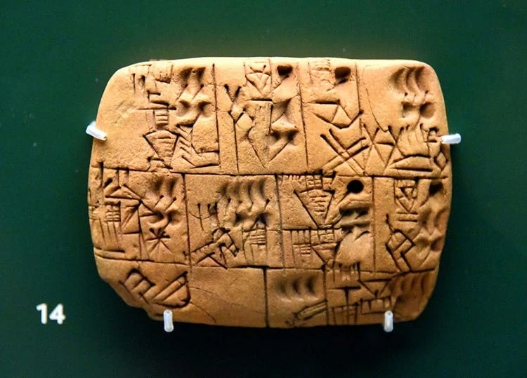
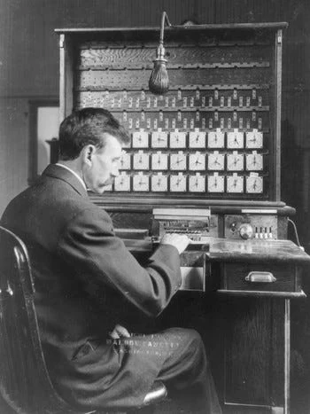
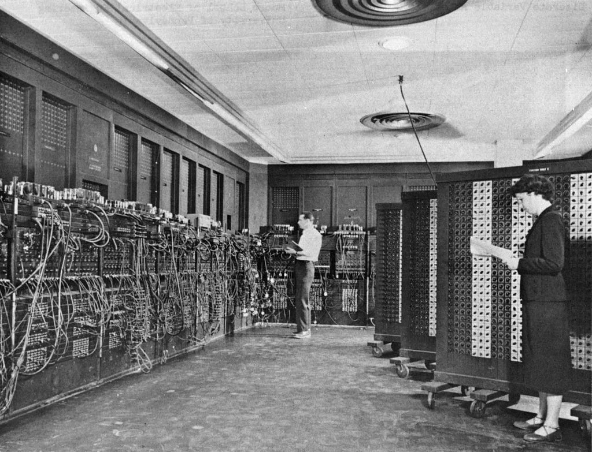
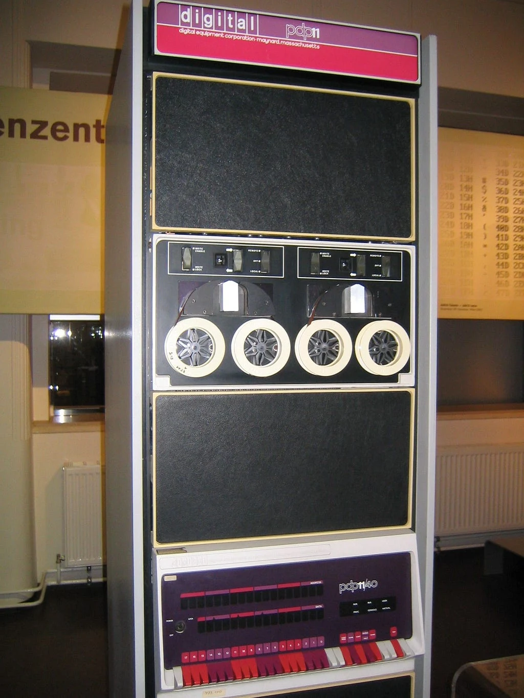

Uzun bir süredir gerek iş yoğunluğum gerekse Yapay Zeka’nın gelişiminin üzerimde bıraktığı bazı etkiler sebebiyle yazı yazmaktan keyif alamıyordum. Bu yapay zeka olayını başka bir yazımda daha detaylı anlatacağım. Ancak bir süredir, özellikle gömülü programlama yapan birisi olarak çok derin konulara dalmamı gerektirecek o kadar işle uğraşınca biraz bu programlama dillerini irdeleyelim istedim.

Hepimiz farklı farklı alanlarda binbir çeşit dil kullanıyoruz. Bugün C ve C++ gömülü geliştirmede ne kadar defacto ise, Python ve R dili bilimsel alanda, PHP(maalesef ki hala PHP) ve Python (Django ve Flask sebebiyle) web alanında ve yine Python yapay zeka alanında çok aktif olarak kullanılıyor.

Hele bir de yakın zamanlarda üniversiteden mezun olan arkadaşlarla ettiğim muhabbetlerde Rust dili çokça kulağıma çalınıyor. Kime sorsan o işin en iyi dili falanca abi, aslında her şeyi sıfırdan şu dille yazacaksın nasıl olsa yapay zeka geldi gibi laflar duymak da mümkün. Bu yeniden yazma ve copyleft’in geleceği de kaygılandıran başka bir konu.

Ama bence kendi lisanımca programlama nedir onu anlatmanın zamanı geldi diye düşünerek bugün buradayım. O zaman başlayalım.

<h2><strong>Sıfırdan başlayalım</strong></h2>

Yazının ortaya çıkışı Sümerlerde buğdayın hesabının tutulması ile başlar. Yaklaşık MÖ 3300 yıllarında, Mezopotamya’daki Uruk kentinde insanlar kil tabletlerin üzerine tahıl miktarlarını, hayvan sayılarını, mal teslimatlarını ve işçilere dağıtılan yiyecekleri kaydetmek için sembollere dayalı bir sistem geliştirdiler.

<figure><figcaption>Sümerlerde Bira dağıtımına dair bir tablet (öyle olduğu iddia ediliyor Sümerce bilmiyorum)</figcaption></figure>

Bu sistemi kullanarak anlaşmalar yapıldı, aşk şiirleri yazıldı ama ilk çıkış noktası akıldan hesapları bir yere tutmaktı. Düşünsene ufak çaplı bir şehirde 5000 kişi var, ve her sene kralın onlara dağıttığı buğdayın doğru hesaplanması sonra kime verildi kime verilmedinin doğru bilinmesi gerekiyor. Toplayın şöyle cevval 10 kişi de ezberlerinde tutsunlar demek mantıklı değil. Bu hesapları tutturdun tamam peki hesaplamaları nasıl yapacağız derseniz, hesaplamaları kolaylaştırmak için sayısal hesap tabloları ve abaküs gibi ilk mekanik araçlar türedi.

<figure><figcaption>Abi bu var olur mu?</figcaption></figure>

Sonra yazı ile ifade edilen şeyler hesap cetvellerine dökülmeye başlandı. Mısır’da taşan Nil nehrinin sildiği tarla sınırlarının ölçülmesi, Çin’de gökyüzü gözlemleri, Avrupa’da açık denizlerde kaybolmamak için yapılan navigasyon hesapları… 1800&#39;lü yıllara kadar tabletlerin yerini kağıda dayalı yazı araçları aldı, hesaplama sistemleri sürekli gelişerek yeni yeni hesaplar yapmak için özelleştirilmiş aletler icat edildi.

Neyse Nuh-u nebiden aldım ama devam edelim. 1800&#39;lü yıllarda Charles Babbage, bu el yordamı ile yapılan hesapları mekanik dişlilerle yapacak bir makine (Analytical Engine) tasarladı; makine, Jacquard dokuma tezgahından ödünç alınan delikli kartlarla programlanacaktı. Ada Lovelace ise bu makine için yazdığı notlarda pek çoğumuzun bugün bile kavramakta zorlandığı bir gerçeği fark etti: Bu makineler sadece sayı saymak zorunda değildi; mantıksal kuralları olan her şeyi, hatta müziği bile işleyebilirdi. Bilgisayar fikrinin kurucusu olan matematikçi kadının hayal ettiği makine hiç tamamlanmadı ama delikli kart fikri yaşadı; 19. yüzyılın sonunda Hollerith’in nüfus sayımı makineleriyle sahneye dönen delikli kart sistemi, 20. yüzyılın ortasına kadar makineye iş anlatmanın standart yolu olarak kaldı.

<figure></figure>

1940&#39;lı yıllar ise bildiğiniz gibi hesap makinesini “bilgisayara” evrilten büyük sıçramalara öncü oldu. Gerçi 2. Dünya Savaşı pek çok şeye öncü oldu, buna Ay’a gitmemiz de dahil. Bu arada hemen bir ürün yerleştirmemi de yapayım:

<a href="/arsiv/v2den-aya-von-braun/">II. Dünya Savaşının Mirası: V-2&#39;lerden, Aya Yolculuğa; Herbert von Braun</a>

Savaşların bu geliştirici etkisi çok da şaşırtıcı değil benim için. Eee ne de olsa 100 bin yıl önce savanalarda birbirlerini öldürmek için sopalar icat eden maymunlardan çok da uzakta değiliz.

Neyse; başta topçu mermilerinin uçuş yollarını hesaplamak (ENIAC), rota hesabı yapmak ve şifre kırmak için elektronik bilgisayarlar icat edildi. Küçük bir düzeltme: Enigma’yı kıran şey Turing ve Welchman’ın tasarladığı elektromekanik Bombe’lerdi; Bletchley Park’ın elektronik bilgisayarı Colossus ise Almanların Lorenz şifresini çözmek için yapıldı. İkisi de bu hikayenin parçası.

<figure></figure>

Fakat bu ilk elektronik bilgisayarların akıl almaz bir derdi vardı: Programlanabilirlerdi ama programı değiştirmek için makinenin başına geçip kabloları sökmeniz, anahtarları tek tek çevirmeniz ve adeta lehimle donanımı yeniden kurmanız gerekiyordu. Delikli kartlar veriyi taşıyordu ama programın kendisi kablolarda ve anahtarlarda yaşıyordu. Unutmayın, bilgisayarın temeli hesaplamadır ama bu şekli ile o hesaplamayı makineye anlatmak bir işkenceydi. Derken John von Neumann ve dönemin mühendisleri devrim niteliğinde bir fikir ortaya attılar: Makine hem işleyeceği veriyi hem de ne yapacağını söyleyen komutları aynı bellekte tutmalıydı. İşte bu adım (stored-program fikri), yazılımın ve dolayısıyla programlama dillerinin gerçek doğum sertifikası oldu. Artık makinenin fiziksel devrelerini değiştirmek zorunda değildik; ona ne yapacağını bir dille anlatabilecektik.

Zamanla bu diller yalnızca toplama ve çıkarma yaptıran basit komut dizileri olmaktan çıktı. Böylece bir dil seçtiğinizde yalnızca iki sayıyı nasıl toplayacağınızı değil; veriyi belleğe nasıl dizeceğinizi, yaptığınız bir hatanın ne zaman kafanıza balyoz gibi ineceğini ve yüzlerce mühendisin aynı kod tabanında birbirini boğazlamadan nasıl çalışacağını da seçmiş olacaksınız.

Bu devrimsel gelişmelerle birlikte programlama dilleri koca bir mutfağa dönüştü. Malzemeyi kesip doğramak salt <strong>hesaplamadır</strong>; tarifleri ayrı sayfalara koyup iş bölümü yapmak <strong>modülerliktir</strong>; bıçağı elinizi kesmeden güvenle kullanmak <strong>bellek güvenliğidir</strong>; aynı anda fırındaki ekmeği yakmadan ocaktaki çorbayı karıştırmak ise <strong>eşzamanlılıktır</strong>. Hepsi aynı mutfağın, yani kısıtlı kaynaklara sahip yani bir silikon yığınınındaki bitlere sıkışmış ve çözüm bekleyen problemleridir. Ve programlama dilleri bunların en az birini en iyi şekilde çözme iddiası ile yola çıkarak, insanların makinelere emirlerini verebilecekleri bir arayüzdür.

<h2><strong>Programlama Dilleri Nasıl Çalışır?</strong></h2>

İşin felsefesini bir kenara bırakıp makine seviyesine indiğimizde, her programlama dilinin aslında birbiriyle sürekli pazarlık halinde olan katmanlardan oluştuğunu görürüz.

En altta donanım ve fiziksel kaynaklar durur: Register’lar, önbellekler, RAM ve diskin sektörleri. Bunun hemen üzerinde dilin en çıplak hali olan <strong>hesaplama çekirdeği (Core)</strong> yer alır. Core dediğimiz şey bir dilde atamayacağınız, indirgenemez asgari matematiktir; değer nedir, bir değişkene isim bağlamak (binding) ne anlama gelir, bir fonksiyon nasıl çağrılır ve koşullara göre yol nasıl ayrılır?

Bu çekirdeğin etrafını <strong>araçlar, kütüphaneler ve tip sistemi</strong> sarar. Burası geliştiricinin kod yazdığı yüzeydir. En dışta ise program çalışırken sahneye çıkan <strong>çalışma zamanı (Runtime) </strong>bulunur; işletim sistemiyle konuşan, görevleri dağıtan veya belleği süpüren görünmez ordu.

İşte dillerin birbirine hiç benzememesinin, her tasarımcının bambaşka bir felsefeyle ortaya çıkmasının sebebi bu katmanlar arasındaki sınır çizgilerini nereye çektikleridir. Çünkü hiçbir programlama dili fildişi kulelerde “hadi canımız sıkıldı biraz matematik yapalım” diye doğmadı; hepsi çok somut bir krizin içinden fırladı.

<figure><figcaption>PDP-11, Unix’in geliştirildiği bilgisayar</figcaption></figure>

Örneğin C, Bell Laboratuvarları’nda PDP-11 üzerinde Unix işletim sistemini ayağa kaldırmak için yazılırken Dennis Ritchie’nin derdi teorik soyutlamalar kasmak değildi. Gerçi Unix’in ortaya çıkışı da bambaşka bir hikaye ama onu başka bir yazıya bırakıyorum.

Ritchie, donanımın sunduğu bellek adreslerine doğrudan, aracısız dokunmak istiyordu. Bu yüzden C, çekirdeğini olabildiğince donanıma yapıştırdı, arkasına hiçbir çalışma zamanı hizmeti koymadı ve belleği yönetme sorumluluğunu tamamen programcının omzuna yıktı.

Böylece donanımın sınırlarını zorlayacak kadar hızlı bir dil ortaya çıktı ancak programlar büyüdükçe “verileri nasıl tasnif ederiz, kim neye dokunabilir?” sorusu büyüdü. Bu sorunun bir cevabı aslında C’den de eskiydi: 1960&#39;ların Simula’sından beri bilinen Object Oriented Programming (OOP), veriyi ve davranışı bir arada tutarak programcıya daha düzenli bir çalışma alanı sunuyordu. Bu yaklaşımı C çekirdeğinin üzerine taşıyan Bjarne Stroustrup, C++ ile donanımın sınırlarını zorlamaya devam ederken programcıya da daha düzenli bir alan sunmayı başardı.

Ancak yıllar sonra Google koridorlarında Rob Pike ve ekibi başka bir sancı çekiyorlardı, devasa C++ projelerinin derlenmesini beklerken kahve içmek, o kadar bekledikten sonra da compile hataları yüzünden saçını başını yolmak gibi bir sancı. Nitekim her sancı kendi çözümünü doğurur ve Pike ile ekibi bu soruna Go ile cevap verdi ki onun da başka sancıları var. Evrim ağacına döndüm ama o da başka bir yazının konusu olsun.

Go’yu tasarlarken amaçları fantezi dolu tip hiyerarşileri değil; binlerce mühendisin yazdığı kodun bir saniyede derlenmesi, ağ paketlerini yormadan dağıtması ve bellek temizliğiyle kimsenin vakit kaybetmemesi lazımdı. Go, derleyiciden ve sözdiziminden karmaşıklığı söküp attı ama faturayı arkada sürekli çalışan bir çalışma zamanı hizmetine havale etti.

Bunu somut bir örnekle görelim. Küçük bir IoT cihazında çalışan sıcaklık okuyucusunu düşünün:

<blockquote>ölç → denetle → kaydet</blockquote>
Bu akışın ortasındaki adım, yani sıcaklık değerini bir eşikle karşılaştırmak (sıcaklık &gt; 40) saf matematiktir. Sümerlerin arpa çetelesinde de aynıydı, 1970&#39;te de aynıydı, bugün de aynı. Hiçbir dil bu matematiği değiştirmez.

Fakat ilk adım sensörle (fiziksel dünya) konuşur; son adım ise diske veya ağ soketine (işletim sistemi kaynağı) yazar. İşin rengi burada değişiyor: Sensör kablosu koptuğunda bu hata nasıl temsil edilecek? Diske yazarken bellek biterse ne olacak? Aynı anda yüz ayrı sensörden veri gelirse iş parçacıkları (threads) birbirinin belleğini ezecek mi? Kil tabletlere kıyasla ne kadar zor sorular soruluyor öyle değil mi?

İşte bu soruların cevabı, hangi katmanın bu yan etkileri taşıdığıyla ilgilidir. Dilin asıl karakteri, kaç anahtar sözcüğe sahip olduğunda değil; işte bu yan etkileri, bellek tahsisini ve hata yönetimini hangi katmana yıktığında ortaya çıkar.

<h2>Bedeli Kim Ödüyor? Karmaşıklık Nereye Taşınıyor?</h2>

Mühendislikte bedava yemek yoktur lafını herkes söyler (bir başka versiyonu ne kadar ekmek o kadar köfte) ama yazılımda bu faturanın nereye kesildiğini pek az kişi açıkça konuşur. Sık sık bahsini geçirdiğim “Karmaşıklık yok olmaz, yer değiştirir” lafı da tam olarak bunu anlatıyor. İş yerinde her gün söylerim bu yazılarada da sirayet edecek. Ancak burada kastedeceğim şey tam olarak bir bütçe meselesidir. Bir programlama dili tasarlarken veya seçerken aslında dört taraflı bir pazarlık masasına oturursunuz: <strong>Geliştiricinin Zihni, Derleyici (Compiler), Çalışma Zamanı (Runtime) ve Donanım.</strong>

Bir taraftan yükü aldığınızda, o yük buharlaşmaz; masadaki diğer üç aktörden birinin kucağına düşer.

Gelin bu pazarlığın taraflarına ve ödenen somut bedellere yakından bakalım:

İlk seçenek faturayı <strong>Geliştiricinin Zihnine </strong>kesmektir. C bu yaklaşımın şahikasıdır. C derleyicisi inanılmaz basittir, saniyeler içinde kodu makine diline çevirir. Arkasında ne bir çöp toplayıcı (Garbage Collector) çalışır ne de karmaşık bir sanal makine vardır; donanımı son damlasına kadar sömürürsünüz. Zaten Dennis Ritchie’nin amacı da buydu: “Ben sana hız vereceğim donanımın sınırlarını zorlayacaksın ama faturayı sana keseceğim.” gerçi o zamanlar geliştiricinin zihnine güvenmekten başka çare yoktu. Bedel sizin dikkatinizdedir. Bellekten aldığınız her baytın yaşam süresini kafanızda takip etmek zorundasınızdır. Bir <em>free() </em>çağrısını unutursanız bellek sızar; fazladan bir <em>free()</em> yaparsanız program havaya uçar; bir dizinin sınırını bir bayt aşarsanız kapıyı saldırganlara açarsınız. C size hız verir ama faturayı gece saat üçte durduk yere patlayan bir yazılımın içinde hafıza sızıntısı arayan, <strong>tanımsız davranışların (undefined behavior)</strong> peşinde saçını yolan mühendisin uykusuzluğu şeklinde tahsil eder.

İkinci seçenek zamanla ortaya çıktı. Programlar büyüdükçe ve geliştirici sayısı arttıkça, faturayı geliştiricinin zihnine kesmek çok pahalıya gelmeye başladı. Bu yüzden mühendisler, faturayı geliştiriciden alıp bir katmana yıkmanın yollarını aradılar. Biz zaten bu programı bilgisayara hesaplatıyorsak neden, faturayı <strong>Çalışma Zamanına (Runtime)</strong> yani programın çalıştığı anda devreye giren görünmez bir orduya kesmeyelim ki? Python, Java veya Go bu yolu seçti. Derlerken sizi kurallarla çok fazla boğmazlar; “belleği ben ne zaman temizleyeceğim?” diye düşünmezsiniz. Çünkü arkada koca bir çalışma zamanı motoru çalışır. Ama bunun da bedeli vardır. Java ve Go’da siz arkaya yaslanırken, arka planda çöp toplayıcı belleği tarar, hangi nesneye hâlâ ulaşılabildiğini izler ve ulaşılamayanları temizler. (Python’ın yolu biraz farklı: o, referansları sayar; Java ve Go ise erişilebilirliği izler. Bu ayrımın neden önemli olduğunu Java yazısında konuşacağız.) Bu temizlik bedava mıdır? Asla. İşlemci döngülerinizden yer, fazladan RAM tüketir ve en kötüsü, tam en kritik anda milisaniyeler süren duraklamalara <strong>(Stop-the-World)</strong> yol açar. Bir web sunucusunda ortalama yanıt süreniz 5 milisaniye olabilir ama o çöp toplayıcı devreye girdiğinde aradaki bir istek 200 milisaniye bekleyebilir. Yani geliştiricinin konforunun bedelini, donanım kaynakları ve öngörülemeyen gecikmeler öder.

<figure></figure>

Tam bu dilemmanın ortasında Mozilla mühendisleri, Firefox’un güvenlik açıklarını nasıl azaltırken bir yandan da performansını koruyabiliriz diye düşündüler, hatta C++ konferanslarına katıldılar, bir çok dilin tasarımını incelediler ve sonunda Rust’ı geliştirme kararı aldılar. Rust, faturayı geliştiriciden alıp çalışma zamanına yıkmak yerine üçüncü bir yol seçti: faturayı <strong>Derleyiciye (Compiler)</strong> kesmek. Rust’ın modern dünyada kopardığı fırtınanın özü tam olarak buradadır. Rust şunu söyler: <em>”Ben faturayı çalışma zamanına kesmek istemiyorum, çöp toplayıcı kullanmayacağım; C gibi hızlı ve öngörülebilir olacağım. Ama faturayı geliştiricinin dikkatsizliğine de bırakamam, güvenlik açıklarına tahammülüm yok.”</em> Bunu yaparken de kağıt üzerinde derleyiciye tüm işi yıktılar, kimse de demedi ki “kardeşim derleyiciye bu yükü bindirmek için dilin içerisine o kadar karmaşık kurallar koyuyorsunuz ki, ne anahtar kelimeleri hatırlamaya mecalimiz kaldı ne de derleyicinin neyi nasıl kontrol ettiğini anlamaya.” Ha bunu yaptıklarında bir yandan da derleyicinin karmaşıklığını artırdılar, derleme sürelerini uzattılar ve geliştiriciyi de derleme sırasında onlarca hata mesajıyla boğuşmaya mahkum ettiler. Rob Pike’nin gözleri yaşlı.

Rust’ta bu yük spesifik olarak <strong>borrow checker</strong> dediğimiz mekanizmaya yıkıldı. Derleyici, derleme sırasında kodunuzdaki her değişkenin sahibini, ne kadar süre yaşayacağını ve kimin kime referans verdiğini matematiksel olarak ispatlamaya çalışır. Bunun sonucunda ne olur? C’de 2 saniyede derlenen bir proje, Rust’ın tip çözümleri, generic açılımları (monomorphization) ve yaşam süresi analizleri yüzünden dakikalarca derlenmez. İşlemcinizin fanları bağırmaya başlar, siz ekran başında kahve içip derleyicinin bitmesini beklersiniz ve kodunuzu derleyiciye beğendirene kadar onlarca derleme hatasıyla boğuşursunuz. Rust güvenliği sağlar ama bedeli derleyicinin sırtına ve geliştiricinin derleme sırasındaki sabrına yıkar.

Örneklerde gördüğünüz gibi ortada kusursuz bir kahraman yok. Kimi dil derleme süresini uzatıp çalışma anını rahatlatır, kimi dil çalışma anına yük bindirip yazımı kolaylaştırır, kimi dil ise her şeyi insana bırakıp makinenin sınırlarını zorlar. “En iyi dil hangisi?” sorusunun bu sektörde 50 yıldır anlamsız bir geyikten öteye gidememesinin sebebi de budur. Çünkü soru “hangi dil daha iyi?” değil; <strong>”ben bu projede faturayı hangi katmandan ödemeye razıyım?”</strong> sorusudur. Hatta eskiden bunu da soramazdınız elimde 20 adam var 10&#39;u C 8&#39;si C++ 2&#39;si Java biliyor, el mecbur C++ geliştiririz, hem Java bilen anlar hem C diyordunuz. Sonra da o kodlarla biz uğraşıyoruz, neyse.

<h2>Bu Yazı Burada Bitiyor Mu?</h2>

Aslında bir yazı olarak kurgulamaya başladım ama sanırım bu yazı serisine dönecek gibi. O zaman programlama dillerinin detaylarına inmek mantıklı gibi.

Yazının sonunda bir kamaşıklık faturası muhabbetine girdik. Peki, madem bu faturanın bir kısmı dönüp dolaşıp donanıma ve insana dayanıyor; yarım asırdır ortalıkta dolaşan, bütün bu modern çözümlere rağmen her yıl güvenlik raporlarının tepesine oturan o meşhur ihtiyar neden hâlâ tahtından indirilemiyor?

C neden hâlâ ölmüyor ve neden bugün yazdığımız en modern işletim sistemlerinden en hızlı veritabanlarına kadar tüm dijital altyapıyı tek başına sırtlamaya devam ediyor?

C’nin o tekinsiz sokaklarına inip, donanımla yapılan o tehlikeli pazarlığın gerçek iç yüzünü konuşacağız.

Sonraki yazılarda okuşmak üzere, esen kalın…

<h2>KAYNAKÇA</h2>

<ul><li><a href="https://go.dev/talks/2012/splash.article">Go at Google: Language Design in the Service of Software Engineering - The Go Programming Language</a></li><li><a href="https://www.nokia.com/bell-labs/about/dennis-m-ritchie/chist.html">Chistory</a></li><li><a href="https://www.seas.upenn.edu/about/history-heritage/eniac/">ENIAC</a></li><li><a href="https://tr.wikipedia.org/wiki/John_von_Neumann">John von Neumann - Vikipedi</a></li><li><a href="https://www.computerhistory.org/babbage/engines/">The Engines</a></li></ul>
