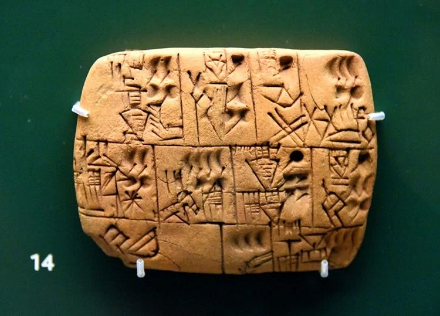
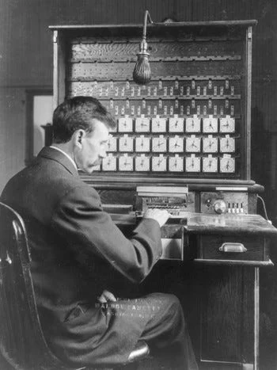
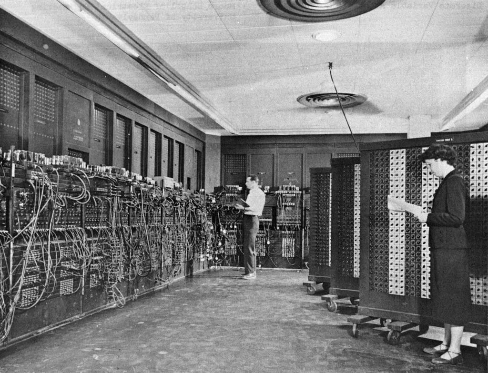
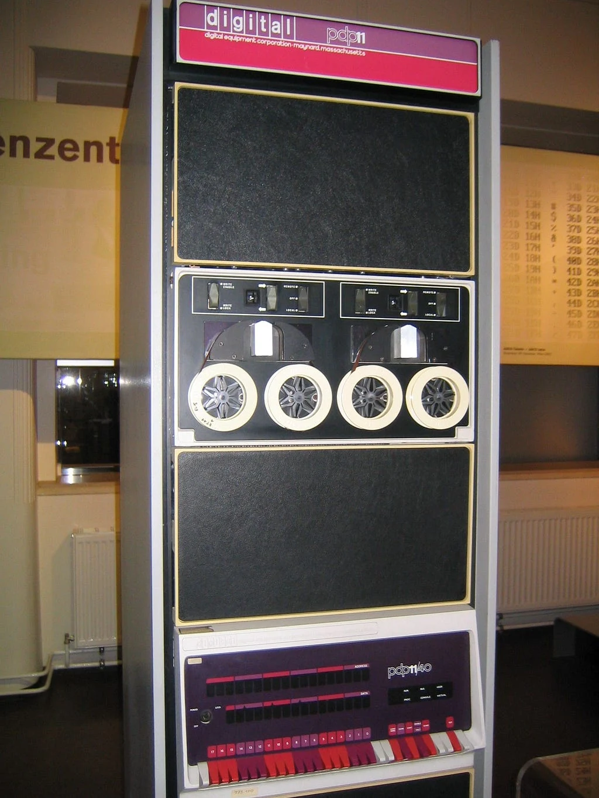
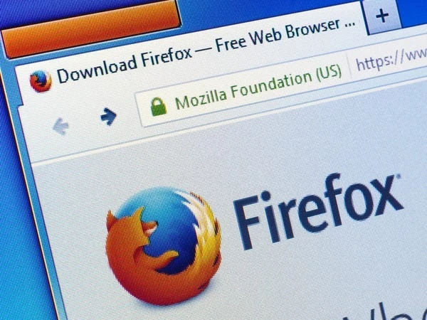

For quite a while, partly due to my heavy workload and partly due to some effects that the rapid evolution of Artificial Intelligence left on me, I wasn't really enjoying writing. I will unpack this AI situation in more detail in another post. However, after dealing with so much work for some time—especially as someone doing embedded programming—that required me to plunge into very deep topics, I thought we should scrutinize these programming languages a bit.

We all use a thousand and one kinds of languages across completely different domains. Today, just as C and C++ are the de facto standard in embedded development, Python and R dominate scientific computing, PHP (sadly, still PHP) and Python (courtesy of Django and Flask) rule the web, and Python once again reigns supreme in artificial intelligence.

And especially in chats with friends who recently graduated from university, the Rust language catches my ear quite often. Whoever you ask, it's always "bro, the best language for that job is X," or you hear claims like "actually you should rewrite everything from scratch in this language, after all AI is here now anyway." This obsession with rewriting and the future of copyleft is another topic of concern.

But thinking that the time has come to explain what programming really is in my own tongue, here I am today. So, let's begin.

<h2><strong>Let's Start from Scratch</strong></h2>

The emergence of writing began with the Sumerians keeping track of wheat. Around 3300 BC, in the Mesopotamian city of Uruk, people developed a symbol-based system on clay tablets to record grain quantities, livestock counts, deliveries of goods, and food distributed to laborers.

<figure><figcaption>A tablet on beer distribution in Sumer (or so it's claimed, I don't know Sumerian)</figcaption></figure>

Agreements were sealed using this system, love poems were composed, but the initial starting point was to record mental tallies somewhere permanent. Just imagine: in a small-scale city of 5,000 people, the wheat distributed to them each year by the king must be calculated accurately, and who got what and who didn't needs to be tracked properly. Saying "let's round up 10 sharp guys and have them memorize it all" makes no sense. You kept these accounts, fine, but what if you ask "how are we going to do the calculations?" To facilitate calculations, numerical tables and the earliest mechanical tools like the abacus emerged.

<figure><figcaption>Bro, could this even be real? :)</figcaption></figure>

Then, things expressed in writing began to be poured into calculation tables. Measuring field boundaries wiped out by the overflowing Nile in Egypt, celestial observations in China, navigation calculations made to avoid getting lost on the open seas in Europe... Until the 1800s, paper-based writing tools replaced tablets, and calculation systems continuously evolved, with specialized tools invented to perform newer and newer computations.

Anyway, I started all the way back from Noah's ark, but let's keep going. In the 1800s, Charles Babbage designed a machine (the Analytical Engine) to perform these manual calculations with mechanical gears; the machine was to be programmed using punched cards borrowed from the Jacquard loom. Ada Lovelace, in the notes she wrote for this machine, realized a truth that many of us still struggle to grasp today: These machines didn't just have to crunch numbers; they could process anything that had logical rules, even music. The machine envisioned by the female mathematician who founded the very idea of computing was never completed, but the punched card idea survived; returning to the stage at the end of the 19th century with Hollerith's census machines, the punched card system remained the standard way of explaining tasks to a machine until the middle of the 20th century.

<figure></figure>

The 1940s, as you know, spearheaded the great leaps that evolved the calculator into the "computer." Though World War II spearheaded many things, including our journey to the Moon. By the way, let me do a quick product placement right here:

<a href="/arsiv/v2den-aya-von-braun/">The Legacy of World War II: From V-2s to the Journey to the Moon; Herbert von Braun</a>

This evolutionary effect of wars is not very surprising to me. Well, after all, we aren't all that far removed from the apes who invented sticks to kill each other in the savannas 100,000 years ago.

Anyway; electronic computers were invented primarily to calculate the trajectories of artillery shells (ENIAC), plot courses, and break ciphers. A small correction: what cracked Enigma was the electromechanical Bombes designed by Turing and Welchman; Bletchley Park's electronic computer Colossus, on the other hand, was built to crack the German Lorenz cipher. Both are part of this story.

<figure></figure>

Yet these first electronic computers had an unthinkable headache: They were programmable, but to change the program you had to stand in front of the machine, pull cables, flip switches one by one, and practically rebuild the hardware with solder. Punched cards carried the data, but the program itself lived in the cables and switches. Remember, the foundation of a computer is calculation, but in this form, explaining that calculation to the machine was sheer torture. Then John von Neumann and the engineers of the era proposed a revolutionary idea: The machine had to store both the data it would process and the instructions telling it what to do in the very same memory. This step (the stored-program concept) became the true birth certificate of software and, consequently, of programming languages. We no longer had to alter the machine's physical circuitry; we could tell it what to do using a language.

Over time, these languages ceased to be mere sequences of simple instructions for adding and subtracting. Thus, when you choose a language, you are not merely choosing how to add two numbers; you are choosing how to arrange data in memory, when a mistake you made will come crashing down on your head like a sledgehammer, and how hundreds of engineers will work on the same codebase without strangling each other.

With these revolutionary developments, programming languages transformed into a vast kitchen. Slicing and dicing ingredients is pure <strong>computation</strong>; placing recipes on separate pages and dividing up the tasks is <strong>modularity</strong>; wielding the knife safely without cutting your hand is <strong>memory safety</strong>; and stirring the soup on the stove without burning the bread in the oven at the same time is <strong>concurrency</strong>. All of them are problems of the same kitchen—that is, crammed into bits on a pile of silicon with constrained resources, waiting for solutions. And programming languages are an interface through which humans can give commands to machines, setting out with the ambition to solve at least one of these challenges in the best possible way.

<h2><strong>How Do Programming Languages Work?</strong></h2>

Setting the philosophy aside and descending to the machine level, we see that every programming language is actually made up of layers constantly bargaining with one another.

At the very bottom sit hardware and physical resources: Registers, caches, RAM, and disk sectors. Right above this lies the barest form of the language: the <strong>computation core (Core)</strong>. What we call the Core is the irreducible minimum mathematics that you cannot strip away from a language: what is a value, what does binding a name to a variable mean, how is a function invoked, and how does execution branch depending on conditions?

Surrounding this core are <strong>tools, libraries, and the type system</strong>. This is the surface upon which the developer writes code. On the outermost layer lies the <strong>Runtime</strong>, which takes the stage while the program is running—the invisible army talking to the operating system, dispatching tasks, or sweeping memory.

The reason languages look nothing alike, and why each designer sets out with an entirely different philosophy, is precisely where they draw the boundary lines between these layers. Because no programming language was born in ivory towers out of "hey, we're bored, let's do some math"; they all burst forth out of very concrete crises.

<figure><figcaption>PDP-11, the computer on which Unix was developed</figcaption></figure>

For instance, when C was written at Bell Labs on a PDP-11 to bring up the Unix operating system, Dennis Ritchie wasn't trying to flex theoretical abstractions. Though the emergence of Unix is a whole separate tale in itself, I'll save that for another article.

Ritchie wanted to touch memory addresses provided by the hardware directly, without intermediaries. That is why C pinned its core as close to the hardware as possible, placed zero runtime services behind it, and dumped the entire responsibility of managing memory squarely onto the programmer's shoulders.

Thus emerged a language fast enough to push hardware to its absolute limits, but as programs grew, the question of "how do we organize data, and who gets to touch what?" grew with them. One answer to this question was actually older than C: Object-Oriented Programming (OOP), known since Simula in the 1960s, offered the programmer a tidier workspace by keeping data and behavior together. Bringing this approach on top of the C core, Bjarne Stroustrup managed to offer programmers a cleaner organization with C++ while continuing to push hardware limits.

Yet years later, in the hallways of Google, Rob Pike and his team were suffering a different agony: sipping coffee while waiting for massive C++ projects to compile, and after waiting all that time, tearing their hair out over compilation errors. Indeed, every agony gives birth to its own cure, and Pike and his team answered this problem with Go—which has its own aches and pains as well. I've turned into an evolutionary tree here, but let that be the subject of another post.

When designing Go, their goal wasn't fancy type hierarchies; they needed code written by thousands of engineers to compile in a second, distribute network packets without breaking a sweat, and ensure nobody wasted time on memory cleanup. Go ripped complexity right out of the compiler and syntax, but handed the bill over to a runtime service constantly running in the background.

Let's see this with a concrete example. Consider a temperature reader running on a small IoT device:

<blockquote>measure → check → record</blockquote>

The step in the middle of this flow—comparing the temperature value against a threshold (temperature &gt; 40)—is pure mathematics. It was the same on the Sumerian barley tally, it was the same in 1970, and it is the same today. No language alters this math.

However, the first step talks to the sensor (the physical world); the last step writes to disk or a network socket (an operating system resource). That's where things get tricky: When the sensor cable snaps, how will this error be represented? What happens if memory runs out while writing to disk? If data arrives simultaneously from a hundred separate sensors, will threads stomp all over each other's memory? Compared to clay tablets, these are pretty tough questions, aren't they?

The answers to these questions depend on which layer carries these side effects. The true character of a language emerges not in how many keywords it possesses, but in which layer it dumps these side effects, memory allocation, and error management onto.

<h2>Who Pays the Price? Where Does Complexity Move?</h2>

Everyone repeats the phrase "there's no free lunch" in engineering (another version being "the more bread you pay for, the more meatballs you get"), but few people speak openly about where that bill actually gets charged in software. The phrase I often bring up, "Complexity doesn't vanish, it relocates," describes precisely this. I say it every day at work, and it will inevitably bleed into these writings too. But what I mean here is strictly a budgeting issue. When designing or choosing a programming language, you actually sit at a four-sided negotiating table: <strong>The Developer's Mind, the Compiler, the Runtime, and the Hardware.</strong>

When you take the burden off one party, that burden doesn't evaporate; it lands right in the lap of one of the other three actors at the table.

Let's take a closer look at the parties to this bargaining and the concrete prices paid:

The first option is charging the bill to the <strong>Developer's Mind</strong>. C is the pinnacle of this approach. The C compiler is extraordinarily simple; it turns code into machine language within seconds. Behind it, neither a Garbage Collector runs nor does a complex virtual machine exist; you exploit the hardware down to the very last drop. After all, that was Dennis Ritchie's objective: "I will give you speed, you will push the hardware's limits, but I'll bill you for it." Though back then, there was no choice but to trust the developer's mind. The cost is your attention. You have to track the lifespan of every byte you claim from memory inside your head. Forget a <em>free()</em> call and memory leaks; add an extra <em>free()</em> and the program blows up; exceed an array bound by a single byte and you open the door wide to attackers. C gives you speed, but collects the bill in the form of sleeplessness for the engineer tearing their hair out chasing <strong>undefined behavior</strong> and searching for memory leaks inside software that spontaneously exploded at three in the morning.

The second option emerged over time. As programs grew and developer headcounts soared, charging the bill to the developer's mind became prohibitively expensive. So engineers looked for ways to lift the bill off the developer and offload it to a layer. If we are already having the computer compute this program, why not charge the bill to the <strong>Runtime</strong>—that is, an invisible army that kicks into gear the moment the program runs? Python, Java, or Go took this route. When compiling, they don't drown you in excessive rules; you don't worry about "when am I supposed to clean up memory?" Because a whole runtime engine is humming in the background. But this comes with a price tag too. In Java and Go, while you sit back and relax, a garbage collector scans memory in the background, tracks which objects are still reachable, and cleans up the unreachable ones. (Python's route is slightly different: it counts references, whereas Java and Go trace reachability. We will discuss why this distinction matters in the Java article.) Is this cleanup free? Never. It eats up processor cycles, consumes extra RAM, and worst of all, triggers millisecond-long pauses right at the most critical moments <strong>(Stop-the-World)</strong>. Your average response time on a web server might be 5 milliseconds, but when that garbage collector kicks in, a request caught in between might wait 200 milliseconds. In other words, hardware resources and unpredictable latencies foot the bill for the developer's comfort.

<figure></figure>

Right in the middle of this dilemma, Mozilla engineers wondered how they could reduce Firefox's security vulnerabilities while preserving its performance; they even attended C++ conferences, studied the design of many languages, and ultimately decided to develop Rust. Instead of taking the bill from the developer and dumping it onto the runtime, Rust chose a third path: charging the bill to the <strong>Compiler</strong>. This is the very essence of the storm Rust kicked up in the modern world. Rust says: <em>"I don't want to charge the bill to the runtime; I won't use a garbage collector; I will be fast and predictable like C. But I also cannot leave the bill to the developer's carelessness; I have zero tolerance for security vulnerabilities."</em> In doing so, on paper they dumped all the work on the compiler—and nobody said, "Folks, to place this burden on the compiler, you're packing so many convoluted rules into the language that we have no energy left to remember keywords, let alone understand what the compiler is checking and how." Well, when they did this, they also increased compiler complexity, stretched compilation times, and condemned the developer to wrestle with dozens of error messages during compilation. Rob Pike is crying in a corner.

In Rust, this burden was specifically offloaded onto the mechanism we call the <strong>borrow checker</strong>. The compiler attempts to mathematically prove at compile time who owns every variable in your code, how long it will live, and who references whom. What happens as a result? A project that compiles in 2 seconds in C won't compile for minutes because of Rust's type resolution, generic expansions (monomorphization), and lifetime analyses. Your CPU fans begin to scream, you sip your coffee at your desk waiting for the compiler to finish, and you wrestle with dozens of compile errors until your code satisfies the compiler. Rust delivers safety, but loads the cost onto the compiler's back and the developer's compile-time patience.

As you can see from the examples, there is no flawless hero here. One language lengthens compilation time to ease the runtime; another heaps burden on the runtime to ease writing; yet another leaves everything to the human to push the machine's limits. This is why the question "Which language is the best?" has been unable to go beyond meaningless banter in this industry for 50 years. Because the question is not "which language is better?"; it is <strong>"from which layer am I willing to pay the bill in this project?"</strong> In fact, back in the day you couldn't even ask that: you had 20 guys on hand, 10 knew C, 8 knew C++, 2 knew Java; by sheer necessity you'd say "we'll develop in C++, both the Java folks and the C folks will understand it." And then we end up dealing with that code, but anyway.

<h2>Does This Article End Here?</h2>

I actually started framing this as a single article, but I think it looks like it's going to turn into a series. In that case, diving into the details of programming languages makes sense.

At the end of the post, we got into this conversation about the complexity bill. Well then, if a portion of this bill circles back and rests upon hardware and humans, why can't that famous veteran—who has been roaming around for half a century and still sits at the top of security reports every year despite all these modern solutions—be dethroned?

Why is C still not dying, and why does it continue to single-handedly shoulder our entire digital infrastructure, from the most modern operating systems we write today to the fastest databases?

We will descend into the uncanny streets of C and talk about the true inside story of that perilous bargain struck with hardware.

Until we read each other in the upcoming articles, stay well…

<h2>REFERENCES</h2>

<ul><li><a href="https://go.dev/talks/2012/splash.article">Go at Google: Language Design in the Service of Software Engineering - The Go Programming Language</a></li><li><a href="https://www.nokia.com/bell-labs/about/dennis-m-ritchie/chist.html">Chistory</a></li><li><a href="https://www.seas.upenn.edu/about/history-heritage/eniac/">ENIAC</a></li><li><a href="https://tr.wikipedia.org/wiki/John_von_Neumann">John von Neumann - Wikipedia</a></li><li><a href="https://www.computerhistory.org/babbage/engines/">The Engines</a></li></ul>
