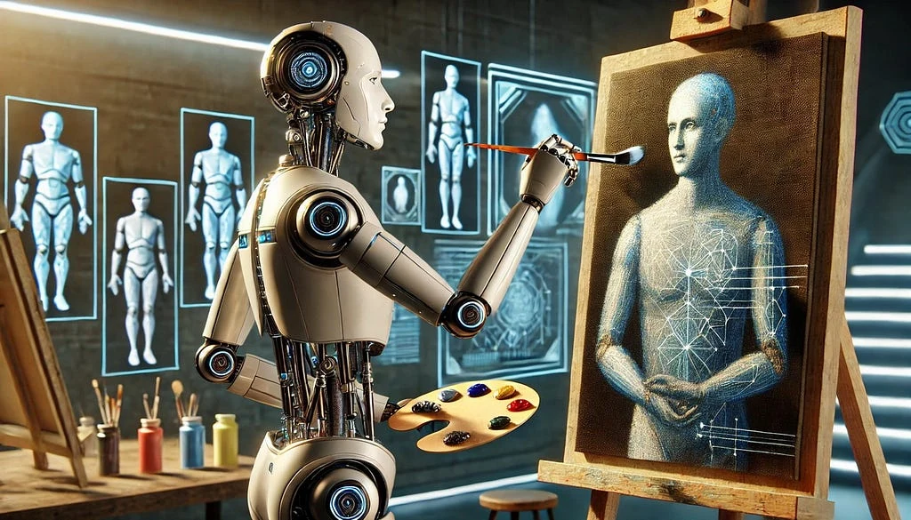
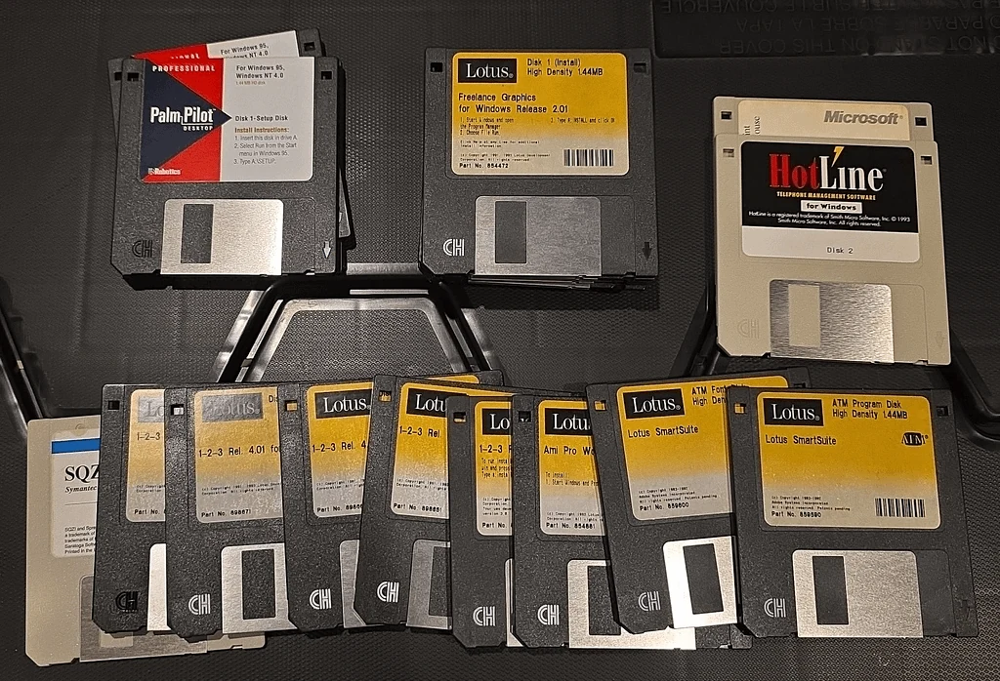
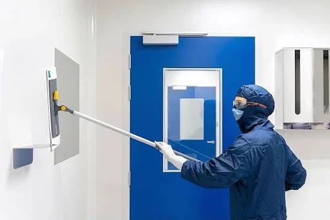
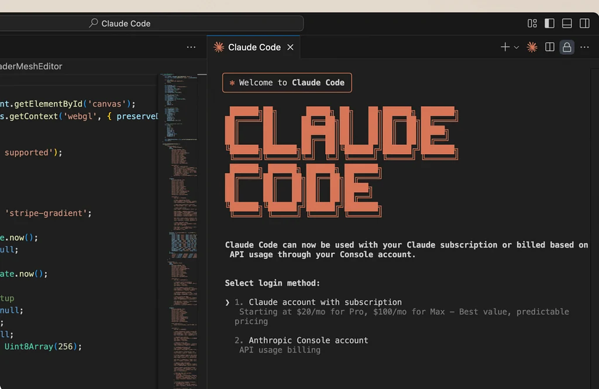
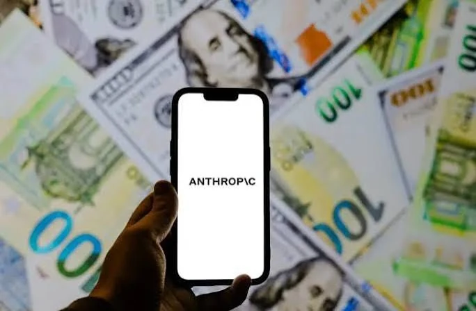
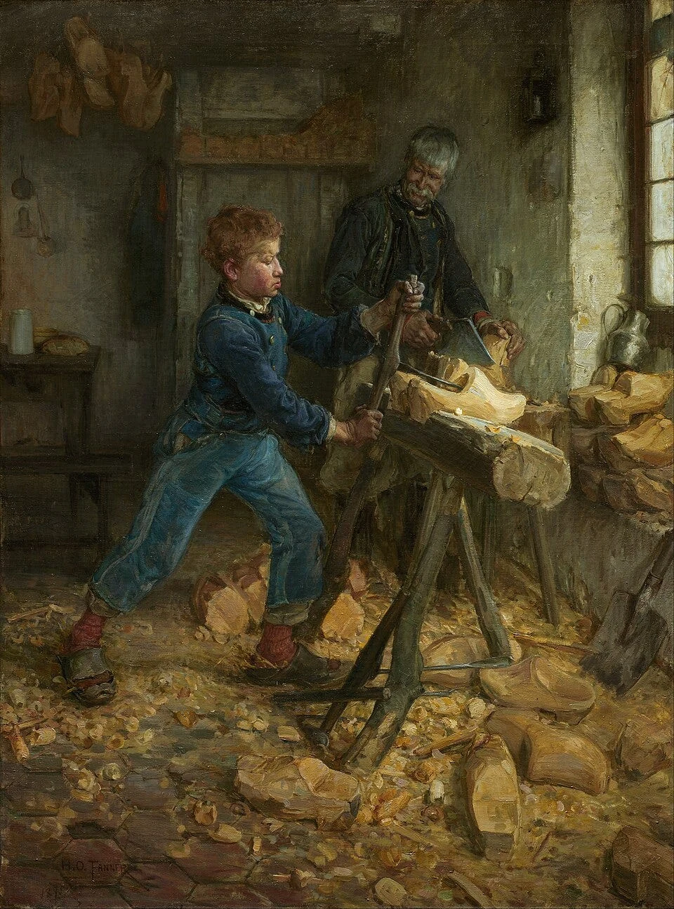
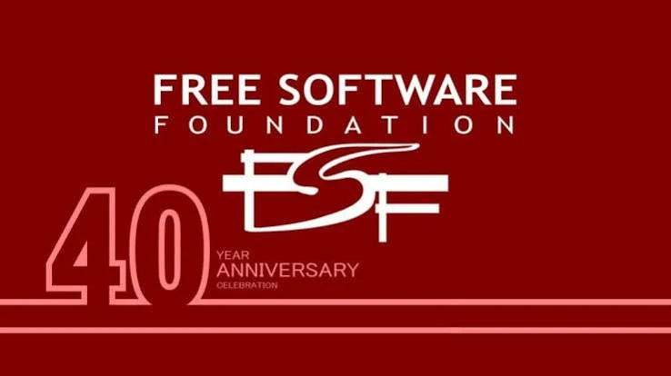
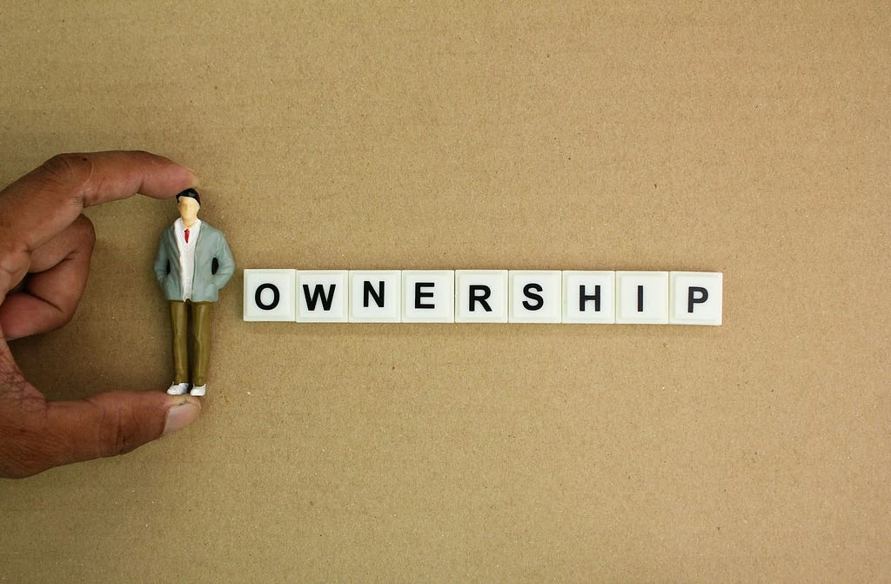

<figure></figure>

<em>Producing software is becoming increasingly easier. So why are we paying more money every passing day to use it? And more importantly, when machines begin working in our place, who will own the value they produce?</em>

In recent days, I wrote an article on how programming languages came about. Those articles will turn into a series, but as I began that piece, I also mentioned that I hadn't been enjoying writing for a while due to the impact the development of artificial intelligence had left on me. In fact, I realize this situation isn't merely about writing. A person strives for years to learn something, to build something. Then one morning they wake up and see that they can now have a machine do a portion of what they spent years learning with just a few sentences.

Whether one should rejoice or despair over this, I'm honestly not sure.

Right in the middle of these thoughts, I stumbled upon a movement called <a href="https://occupysaas.com/">OccupySaaS</a>. At the very top of their website, it reads:

<strong>“They laid us off. We’re rebuilding their SaaS.”</strong>

Roughly speaking: "They laid us off. We're rebuilding their SaaS."

At first glance, it looks like an attempt by an angry group of developers to stand up to big tech companies. Which, in fact, it is. Who would have thought the most bourgeois of white-collar workers would raise the banner of rebellion… But when I poked around the site a bit, I thought there might be more to it than just a few open-source projects. And I began contemplating the possibility that these elites, whom I had viewed with a slightly mocking eye, could actually spark a revolution.

If you ask why, this initiative is a small but remarkably concrete example of a question that has been nagging at my mind regarding artificial intelligence for a long time:

<strong>Why isn't the ownership of production changing while the means of production are changing?</strong>

Maybe they will achieve huge things, or maybe this initiative will leave no trace in the software universe. Regardless, this organization… In recent days, Evrim Ağacı's video titled <em>What Will You Do When Artificial General Intelligence Arrives?</em> also led me to a similar question. I leave its link below as well:

<a href="https://www.youtube.com/watch?v=Ec9jyLqYpxg">What Will You Do When Artificial General Intelligence Arrives? — Evrim Ağacı (YouTube)</a>

If machines can do the vast majority of tasks humans can do in the future, what will be the place of humans in economic life?

Seeking the answer to this question solely in the pace of technological development strikes me as incomplete. One needs to look a bit at history, a bit at economics, and a bit at computer science itself. That is why I came here to write this.

Anyway, before starting all the way from Noah's ark again, let's start with SaaS.

<h2>How Did Software Turn into Real Estate?</h2>

The software industry has undergone an interesting transformation.

<figure><figcaption>Old-timers shed a tear</figcaption></figure>

Once upon a time, software was sold in physical boxes on floppy disks. You bought the program, installed it on your computer, and used it. Of course, license restrictions, upgrade fees, and all sorts of rules imposed by the manufacturer still existed. But at least running the program occurred mostly on your own machine. Over time, CDs replaced floppy disks. But their lifespans weren't very long either.

With the proliferation of internet connectivity and the rise of cloud computing, <strong>Software as a Service</strong>—the SaaS model—settled into the center of our lives. Instead of buying software, we began renting access rights to it. In fact, one of the biggest examples of this is Steam. Yes, the gaming industry was one of the places where SaaS evolved fastest.

<figure></figure>

One shouldn't be too surprised by this. When you bought a game on Steam, you bought it once. No hassle of buying CDs over and over, or hunting down and digging up those disks every time you format your computer. Updates happen automatically, and you can access the same data from different devices. How lovely, right? As a gamer, certainly, but what about businesses? Consider that thanks to this structure, it became possible for a small business to use systems tailored to their own needs that previously only large corporations could afford—with SAP being one of the prime examples. Instead of purchasing a massive piece of software, you buy business packages piecemeal according to your needs, and then sit back waiting for them to load from a single service. You don't have to deal with massive piles of disks, nor do you have to shell out cash for the entire software suite.

So far, so good.

Yet over time, another attribute of easy access surfaced: <strong>Dependency.</strong>

For example, imagine you start a small business. You have a team of five people. You use one CRM to manage your customers, another service for your documents, a separate app for internal team communication, and yet another infrastructure for authentication.

Business grows. The five-person team becomes fifteen.

Normally, one would think: The development cost of this software has long been covered, and the marginal cost of adding a new user is quite low for certain services. Therefore, as software scales, the cost per user could be expected to decrease.

But not every SaaS is priced that way. When you become fifteen people, your bill might triple as well. Of course, an important distinction must be made here. The cost of running software does not consist merely of CPU time or RAM consumption. Technical support, security, regulatory compliance, data retention, and continuous development also cost money. Thus, per-user billing is not an outright scam in and of itself.

However, the moment pricing begins to depend not on the service provided, but on <strong>the customer's inability to exit the system</strong>, the tables turn.

Your customer records, automations, business processes, third-party integrations, and your employees' habits are now shaped around that platform. Even if you wanted to migrate to another system, doing so carries a formidable cost. That is precisely what is known as <em>vendor lock-in</em>.

For years you build your company's processes inside a piece of software. After a while, that software starts dictating the way you work.

It even reaches such a point that migrating your own data elsewhere turns into an entire engineering project on its own.

<strong>In the past, we bought computers to run software. Today, we pay continuous rent just to access the software that makes the computer useful.</strong>

If you ask me, this is the core issue OccupySaaS is protesting.

<h2>From 1983 to 2026: A New Free Software Movement?</h2>

It would be unfair to say this debate is new.

<figure></figure>

In 1983, when Richard Stallman announced the GNU project, he proposed developing an operating system compatible with Unix that people could freely use and modify.

Notice, the topic was not merely free-of-charge software; it was free software (libre software).

It was about being able to study how the software works, modify it, share it with others, and improve it according to your own needs.

Because if you cannot access the source code of a software, your control over what that software does on your computer remains limited.

Over the years, GNU, Linux, and countless open-source projects demonstrated that this philosophy wasn't merely a romantic engineering daydream. Today, countless systems—from servers running on the internet to the infrastructure of the programming languages we use—stand atop this culture.

Yet in the more than forty years that have elapsed, an intriguing situation emerged.

Companies leveraging the infrastructure provided by open-source software transformed services developed on top of this foundation into gargantuan commercial platforms.

There is no inherent contradiction here on its own. Using open-source software commercially is already something explicitly permitted by many licenses.

The real debate is how difficult these platforms make it over time for users to transition to other systems.

The Occupy Wall Street movement that emerged in 2011 debated economic inequalities through the lens of the 1% and the 99%.

OccupySaaS, in 2026, carries a similar rhetoric into the software industry.

On one side are the engineers who produce, maintain, and develop the software. On the other side are the entities controlling access, distribution, and commercial value of the software.

OccupySaaS's premise is this: If the people building these systems are being laid off and artificial intelligence is driving down software production costs, why don't we build open-source alternatives compatible with existing platforms ourselves?

In a sense, the free software philosophy of 1983 is being reinterpreted with the artificial intelligence tools of 2026.

Only this time, the target is not merely a free operating system, but the commercial services companies pay invoices for every month.

And in my opinion, the most technically interesting side of the matter begins right here.

<h2>Rebuilding the Same Software Without Taking the Source Code</h2>

OccupySaaS's approach relies on the methodology known as <em>clean-room implementation</em>.

<figure></figure>

In this method, instead of copying another software's proprietary source code or reverse-engineering its internals, you build an independent implementation utilizing publicly available technical documentation and standards. They currently have two active projects, which I will mention.

The goal in this project is not to recreate the identical internal architecture, but to construct a system compliant with the specified external behaviors.

For example, consider standards like OAuth 2.0 and OpenID Connect.

When an application wishes to authenticate a user, it redirects to an authorization server. The server verifies the user and issues authorization codes or tokens according to specific protocol rules. The application then checks their validity and grants the user access.

The system running behind this operation does not necessarily have to belong to a specific company. What matters is the accurate implementation of the protocol and the behaviors expected by the application. One of OccupySaaS's first projects, <a href="https://github.com/occupysaas/zeroauthy">ZeroAuthy</a>, is built on precisely this premise.

The project aims to develop an authentication server compatible with Auth0. The goal is to allow applications using existing Auth0 SDKs to connect to an alternative server with minimal to no code changes. In theory, a very powerful concept. Because freedom here stems not solely from source code being open; <strong>it stems from reducing the cost of leaving the existing system.</strong>

Yet there is also an unseen side to the coin. Two systems having identical HTTP endpoints does not mean they are fully compatible. Token lifetime management, refresh token rotation, error responses, rate limiting, user session invalidation, data isolation in multi-tenant architectures, and especially security boundaries must satisfy the same expectations.

Seeing an endpoint returning 200 OK in an authentication system does not prove the system is secure. A misconfigured JWT validation or flawed tenant isolation can leave the entire system exposed to attacks.

Indeed, ZeroAuthy notes that it is still in early stages. Still, public tests, compatibility efforts, and documentation regarding OpenID Connect certification show that the project is not a mere surface mimicry.

The second project is <a href="https://github.com/occupysaas/salescompel">SalesCompel</a>. This time the target is Salesforce. As someone who has built CRM systems, I can tell you this one is far more convoluted. Storing a customer's name, phone number, and email address in PostgreSQL is the easy part. Keeping customer permissions, dynamic data models, sales pipelines, automations, integrations, transaction integrity, and data migration running smoothly for years is a completely different beast.

Viewing a CRM system as consisting merely of CRUD operations is like viewing an automobile as consisting merely of four wheels and a steering wheel. SalesCompel's own roadmap clearly reveals that full compatibility is not yet achieved, and data migration, security, automation, and production-grade verifications significantly await completion. In other words, there is no system here mature enough to cancel your Salesforce subscription tomorrow morning.

But the objective isn't merely evaluating today's two projects. Because what is truly shifting is <strong>the nature and cost of human labor</strong> required to develop such systems.

<h2>Artificial Intelligence: The Cause of Our Unemployment or the Tool of Our Liberation?</h2>

<figure></figure>

We have arrived at the most controversial and brain-tickling aspect of OccupySaaS.

The movement proposes that laid-off engineers recreate the products of big tech companies using AI agents.

<strong>Wait a minute.</strong>

Engineers who believe they lost their jobs due to AI are going to use AI to compete with the companies that laid them off(?).

Sounds a bit tragicomic, doesn't it?

Moreover, attributing all layoffs in the tech sector solely to AI is inaccurate. Interest rates, post-pandemic overhiring corrections, corporate cost-cutting policies, and shifting investment climates are all part of this process. But there is a more fundamental transformation taking place here. Artificial intelligence can drastically reduce the time humans need to expend, especially during certain phases of software production.

A mundane REST API, data model, or admin interface that would previously take a developer days can today be prepared in vastly shorter time using AI tools. However, turning a job that took days into code in a few minutes does not guarantee that the code will run reliably for years.

<blockquote>Because writing code and practicing engineering are not the same thing.</blockquote>

I want to emphasize this point in particular. Verifying the security of produced software, taking precautions against data loss, handling erroneous states, maintaining consistency, and keeping the system standing under unexpected loads remains a serious engineering endeavor.

AI may play an increasingly larger role in some of these tasks as well. Yet today, a wide gap exists between a model generating code very quickly and proving a system's reliability. OccupySaaS aims to bridge this gap through technical contracts, open specifications, compatibility testing, and human review.

In my opinion, this is what makes this movement significant.

Instead of telling AI "Build me Salesforce," they propose specifying testable behaviors and incrementally developing a system that fulfills them. Thus, a substantial portion of software engineering shifts from writing code directly toward <strong>defining what code must do and proving whether it actually does it</strong>.

<figure></figure>

In my last article while explaining programming languages, there was a recurring thought I kept returning to: Complexity doesn't vanish, it relocates. That is somewhat what's happening here too. You drive down the cost of writing code. But the cost of properly defining system behavior, verifying the generated code, and maintaining it over the long haul does not disappear. It merely migrates to other layers.

Therefore, software development becoming cheaper thanks to AI does not mean software engineering disappears entirely. But the possibility of companies needing fewer employees to produce the same volume of software cannot be ignored either.

So who will benefit from this surge in productivity?

That is the question that concerns me.

<h2>Who Will Own Capital While Machines Do the Work?</h2>

<figure></figure>

Now let's come to what will happen when Artificial General Intelligence (AGI) arrives.

The aspect of this issue that made me ponder wasn't exactly when AGI will be developed or what feats it will be capable of.

It was how humans will be positioned in that economy if we one day reach a world where a significant portion of economic activities humans can perform can be automated.

Imagine you own a factory. Previously you employed a hundred workers. With new automation systems, you become able to achieve the same output with ten workers. Your production remained the same, or even increased. Economically speaking, the productivity gain is immense.

Yet how the remaining ninety people will earn their living is a separate dilemma. This dilemma was once the question that nagged at Karl Marx's mind, and it is the question that prompted him to write Das Kapital.

Now apply this scenario not only to a factory, but to software companies, logistics, the financial sector, design, accounting, and over time to more domains. Of course, throughout history automation created new professions as well. Humans moved from agriculture to industry, and from industry to the service sector. One cannot claim that technological advancements will always inevitably result in permanent mass unemployment.

Yet what makes the general-purpose artificial intelligence premise distinct is the possibility of automating not merely specific tasks, but newly emerging jobs as well.

We do not yet know whether this scenario will materialize.

Still, if we take the possibility of its realization seriously, assuming the economic order will remain unchanged is somewhat bizarre. Because in today's system, the vast majority of people earn their livelihood by <strong>selling their labor</strong>. The owner of the factory owns the machine. The worker owns their labor. If the production process requires progressively less human labor, what will become of the bargaining power of the person who makes a living by selling their labor?

Even more critically, who will own the surplus value created by automation? A system developed by a programmer can be used by millions of people. Yet ownership, distribution, and monetization of that system mostly do not belong to the programmer themselves.

Now think about it.

An engineer works for years on developing a SaaS platform. Over time, the platform attains tremendous economic value. Later, the company decides it needs fewer engineers by using new automation tools. The engineer loses their job. But the system they contributed to developing continues to operate and generate revenue.

We cannot say there is a legal injustice here on its own. The property and compensation relationship between company and employee is defined by contracts. You enter agreeing that the code you write belongs to the company, and in return you receive a monthly salary. Just like people working in a shoe factory own the salary deposited at month's end rather than the shoes they manufacture. Of course, given that they earn money for every step taken in these shoes, and the gears can keep turning even if you don't produce new shoes, there is a world of difference between being a SaaS developer and being a shoe factory worker.

<figure><figcaption>I hope those who know what a 'sabot' is understood why I gave the shoe worker example</figcaption></figure>

Yet from an economic and social standpoint, we must ask another question:

<strong>When the accumulation created by human labor begins needing less human labor, how will the returns of that accumulation be shared?</strong>

Unfortunately, OccupySaaS does not offer an answer that redesigns the entire economy. What it is doing is more like protesting by shouting "BOOOO."

Yet it presents quite an intriguing reaction.

Since we lack ownership over the existing means of production, let us collaboratively build alternative means of production.

This is a notion far distinct from merely competing with a SaaS company on price.

<h2>Is Open Source Truly an Escape Route?</h2>

<figure></figure>

Here one needs to be somewhat critical.

The existence of open-source code does not automatically translate to a democratic distribution of economic power.

A software being hosted on GitHub and released under the Apache 2.0 license does not mean everyone will derive the same economic benefit from it. After all, having access to source code is one thing; having the resources to operate it reliably and at scale is another.

For instance, suppose you decide to self-host a SaaS service. You can escape the subscription fee. But you will still need servers, backup systems, network security, monitoring infrastructure, updates, and humans to intervene when needed. Sometimes managing all of this yourself can even turn out more expensive than buying a subscription to a commercial service. Spinning up a CRM server in a Docker container is not the same thing as operating it for five years without losing your customers' data.

And there is an even deeper dimension to the matter. Permissive licenses like Apache 2.0 permit code to be used commercially and integrated into closed-source products under certain conditions. In other words, another company tomorrow could take a project built by OccupySaaS and use it inside the infrastructure of their own commercial service. That is an outcome of the freedom granted by the license. Yet thinking about this, an ouroboros—a serpent devouring its own tail—flashed before my eyes.

Yet it is also an issue that must be debated from the perspective of the argument the movement develops against the concentration of economic power.

More importantly, there is the question of long-term sustainability for open-source projects. Who will be the people developing the software? Who will remediate security vulnerabilities? It's great to have hundreds of people contributing to a project. But five years down the line, when a critical database bug appears, who bears the responsibility must also be established.

These are not insurmountable issues. Yet measuring the success of free software merely by GitHub stars or lines of code written is also not accurate.

Perhaps the most significant transformation AI will bring to this realm is enabling small teams to develop projects that previously only large corporations could execute. But for this to constitute a true alternative, models of financing, governance, security, and maintenance must evolve alongside code generation.

<strong>Liberating a software's source code is not the same thing as liberating the power to run it.</strong>

And once again we return to the same question: Who controls production?

<h2>Perhaps the Real Revolution Isn't Writing New Software</h2>

I don't know whether OccupySaaS will succeed. Perhaps in a few years they will produce projects that truly serve as alternatives to massive SaaS platforms. Or perhaps a portion of their projects will lose developer community interest and be abandoned.

Both are possible. But I think this initiative has an important dimension: For the first time, the assumption that certain services offered by big tech companies are too complex to ever be rebuilt is being more seriously questioned.

Of course, rebuilding existing systems does not always make sense. Building a system from scratch can also be more costly than adopting an existing, mature open-source alternative. Still, it is evident that AI accelerating code generation will lower the technical barriers to competition in certain software markets. And that could weaken a portion of the economic advantages existing corporations have established through pricing and user lock-in.

Yet there is another irony here. A portion of the AI models OccupySaaS utilizes to produce open-source alternatives also depend on the infrastructure of large tech companies. That is, while producing alternative software against SaaS monopolies, you might this time become dependent on AI providers.

While eliminating one dependency, it is entirely possible to create another. For that reason, I don't believe the issue is solely swapping SaaS services for open-source. Over the long run, we also need to debate who controls compute power, models, data centers, software infrastructures, and the economic value arising from them.

If AI will boost human productivity, that is wonderful. If one person can accomplish what ten people previously did, if we can produce more with fewer resources, there is no reason humanity shouldn't benefit from this.

Yet a productivity increase and sharing prosperity are not the same thing.

A technology can generate tremendous economic value. Whether that value spreads across broad segments of society is determined not merely by technological capacity, but by institutions, competition, property relations, and political choices.

That is why, if you ask me, the real question is not "Will AI take all our jobs?"

<strong>Can we build a world where we don't have to work thanks to AI, or are we heading toward a world where fewer people capable of working are needed, but working is still mandatory to make a living?</strong>

The two are remarkably different. In one, automation liberates people. In the other, the economic advantage created by automation can concentrate in the hands of those who own the means of production.

And movements like OccupySaaS may perhaps sound like small cries in the struggle between these two futures—for now…

<h2>In Lieu of a Conclusion: Whose Code Is It, Whose Future Is It?</h2>

<figure></figure>

Looking at the developments in the software world over the past few years, I experience conflicting emotions.

On one hand, there is tremendous excitement. We can build vastly more complex systems with vastly fewer resources. Some tasks that previously required large teams can now be executed by small teams.

On the other hand, watching how the economic value of a skill a person spent years painstakingly learning transforms is a strange sensation.

Perhaps the true discomfort lies right here.

For years, we have been explaining to computers how to compute.

First we used machine code, then assembly—I wasn't around for those eras, but we used C, C++, Java, Python, and many more that followed, developing various tools. With each generation, we made talking to machines a little easier.

Now at the point we have reached, we can explain what we want to do to the machine using natural language. This is a profoundly impressive milestone in the historical evolution of computer science.

Yet if at the end of all these advancements we can produce more with less human labor, is it really so bizarre to expect that to return to humanity as more time and freedom?

When I look at OccupySaaS, what I see is not just a bunch of engineers angry at big SaaS corporations. It is simultaneously an objection directed at the distribution of the value created by technology. I don't think this objection has all the answers. I even have serious question marks about how successful existing projects can be in the long run.

Yet I think the question it raises is vital. Today we object to the per-user pricing of a SaaS service. Tomorrow we may be debating the fees we pay to access AI models, the ownership of compute resources, or the revenues generated by fully automated production systems.

Perhaps in this new era, the idea of free software will need to be rethought not merely to cover code, but to encompass the infrastructures running that code and the underlying economic relationships. After all, we don't want to become tenants of the software we wrote.

Yet there is a more crucial question:

<strong>One day when machines begin working in our place, will we be able to own those machines? Or will we pay rent just to use what they produce?</strong>

I suspect this will be one of the most critical debates of the coming era.

Stay well.

<em>Note: My evaluations regarding the technical maturity of OccupySaaS projects are based on the project documentation in their GitHub repositories as of November 2, 2026, when I discovered this organization. The sections concerning Artificial General Intelligence are not definitive expectations of the future, but rather my projections and commentary on possible economic scenarios.</em>

<h2>References and Further Reading</h2>

<ul><li><a href="https://occupysaas.com/">OccupySaaS - They laid us off. We're rebuilding their SaaS.</a></li><li><a href="https://github.com/occupysaas">Occupy Saas</a></li></ul>
