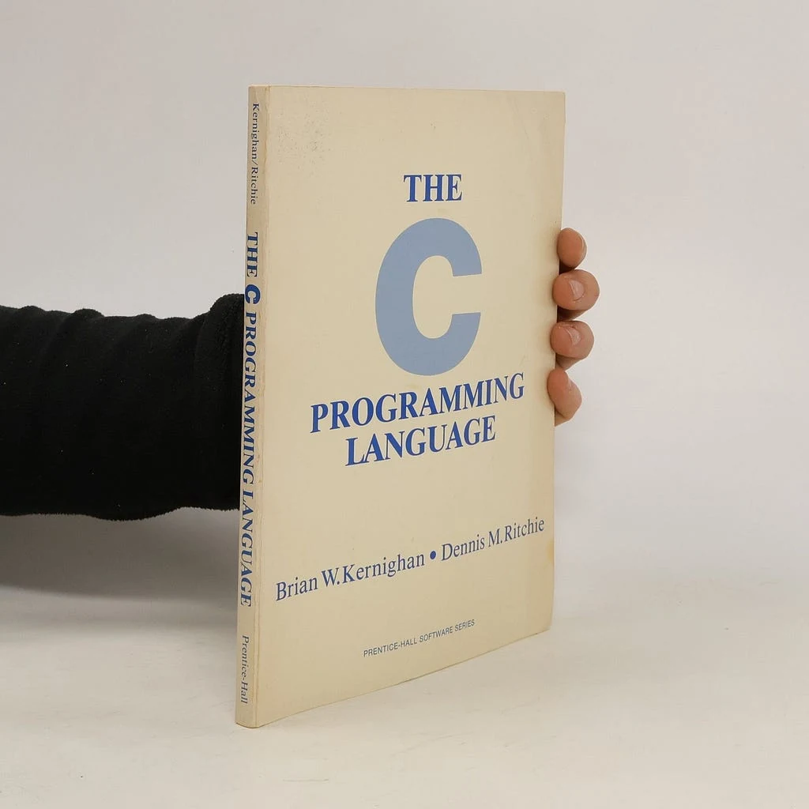
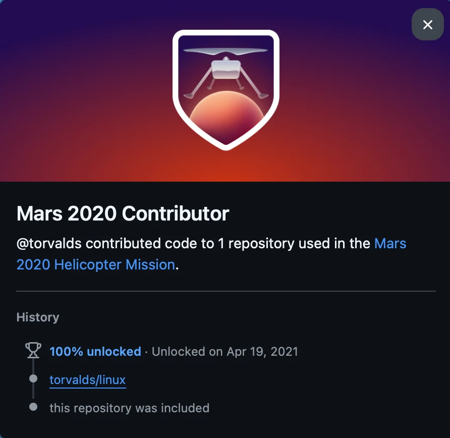
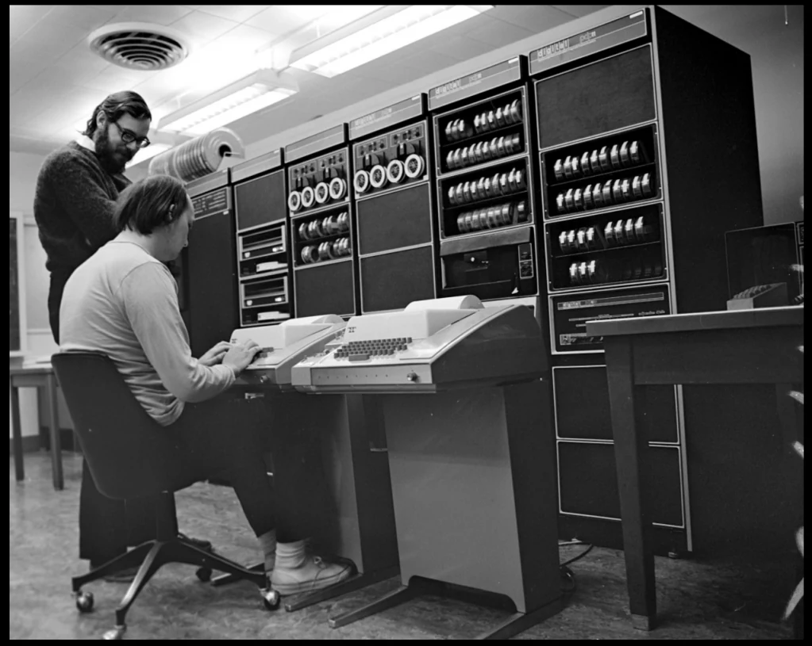
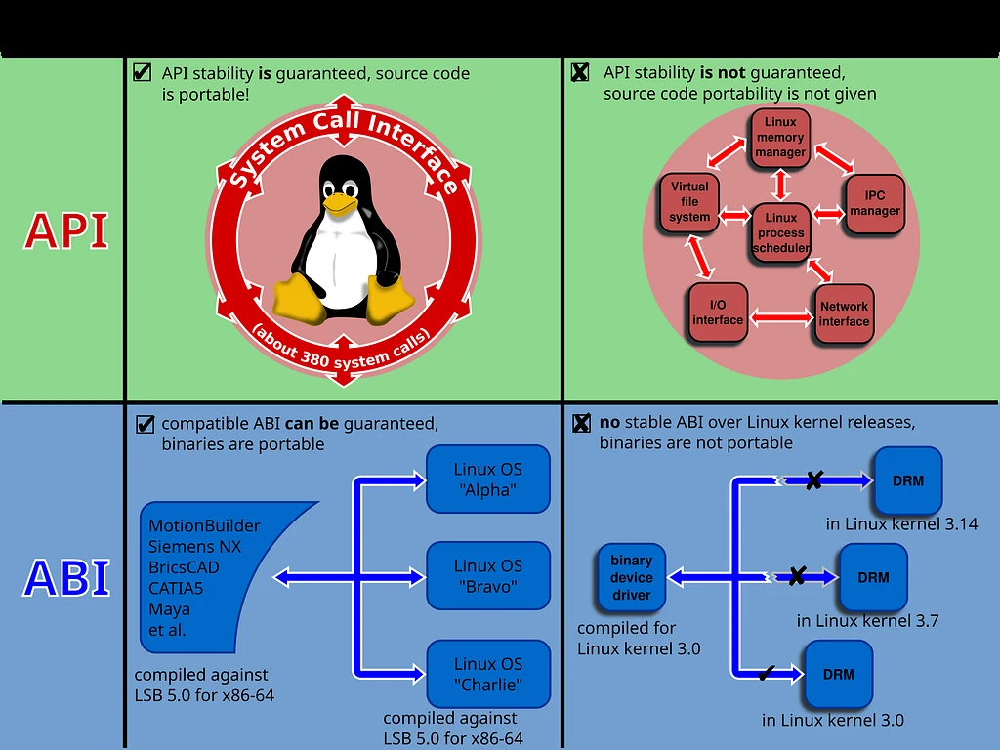
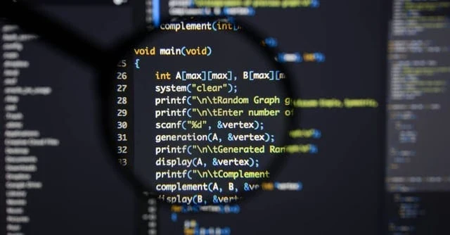
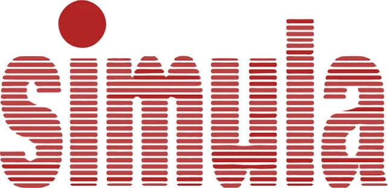

<figure><figcaption>C diline ait kitabın ilk versiyonu</figcaption></figure>

Daha önce Java’yı öldürdüğüm yazıyı bilenler bilir.

<a href="/genel/internet/tabut/">Düşenin Tabutuna Bir Çivi de Sen Çak</a>

Bu yazı aman öldü aman ölmedi minvalinde bir yazı olmayacak. Rust developer’lara rağmen neden hala language leaderboard’da C hep başta onu tartışacağız.

<h2><strong>Dışarıdan Görünen İllüzyon</strong></h2>

Yazılıma yeni başlayanların ya da sektörün sadece popüler web çerçeveleriyle ilgilenen tarafında kalanların sıkça düştüğü bir yanılgı vardır: C’nin 1970'lerden kalma, artık miadını doldurmuş, sadece üniversitelerde öğrencilere eziyet olsun diye gösterilen müzelik bir dil olduğunu sanırlar. Hatta biraz daha ileri gidip “Hâlâ C mi yazıyorsunuz, Rust varken C mi kaldı?” diyenleri her kahve molasında veya forum köşesinde duyabilirsiniz. İşte o arkadaşlara söyleyecek çok şeyim var da. Neyse…

Siz hayallerinizde her şeyi “rustification”la uğraşırken gerçek dünyada durum bambaşka. Sabah uyandığınızda elinize aldığınız akıllı telefonun işletim sistemi çekirdeğinden (ister Android’in Linux çekirdeği olsun, ister iOS’in XNU/Darwin’i), bilgisayarınızı açtığınızda çalışan Windows NT çekirdeğine (Windows’un C++ kullanımı ezoterik bir C kullanımı gibi olduğu için bunu diyorum) kadar her şey C ile nefes alır. Kodunuzu push’ladığınız Git, Mars’ta 72 uçuş yapan Ingenuity helikopterinden fırınınıza kadar her akıllı cihazda gömülü çalışan Linux çekirdeği, dünyanın en yaygın veritabanı olup her Android telefonun ve her iPhone’un içinde gömülü duran SQLite, mikro saniyelerle yarışan Redis, büyük bankaların omurgasını oluşturan PostgreSQL… Hepsini geçtim; veri bilimcilerin ve yapay zekacıların yere göğe sığdıramadığı Python’ın asıl yorumlayıcısı (CPython) bile baştan aşağı C ile yazılmıştır.

<figure></figure>

Yani siz klavyenizde bir tuşa bastığınız andan monitörünüzde bir pikselin yanmasına, internetten bir paket indirmenizden ekrana bir web sayfası çizilmesine kadar geçen her milisaniyede aslında farkında olmadan C’nin üzerinde yürürsünüz.

Peki nasıl oluyor da yarım asır önce, iki adamın bir laboratuvar köşesinde daktilo benzeri terminallerle yazdığı bir dil, bunca teknolojik devrime ve onlarca modern dile rağmen tahtından indirilemiyor?

<h2><strong>Taşınabilir Assembly: Donanıma Eldivensiz Dokunmak</strong></h2>

Bu sorunun ilk cevabı C’nin felsefesinde, daha doğrusu felsefesizliğinde gizlidir.

1960'ların sonunda Dennis Ritchie ve Ken Thompson, Bell Laboratuvarları’nda iki farklı duvara çarptılar. İlki Multics’ti: MIT, GE ve Bell Labs’in birlikte yürüttüğü, birden fazla kullanıcının aynı anda bilgisayarı paylaşabildiği o devasa zaman paylaşımlı işletim sistemi projesi öyle hantallaşmıştı ki Bell Labs 1969'da projeden çekildi. Thompson ve Ritchie, Multics’in sunduğu o rahat çok kullanıcılı ortamı özlüyorlardı ama ellerinde köşede unutulmuş bir PDP-7'den başka bir şey yoktu. Unix tam olarak buradan, “Multics’in iyi fikirlerini küçücük bir makineye sığdırabilir miyiz?” sorusundan ortaya çıktı. İşletim sistemini yazmaya çalışırken devasa bir duvarla daha karşılaştılar. O dönemde işletim sistemleri çoğunlukla doğrudan Assembly ile yazılırdı (Multics’in PL/I ile yazılması cesur bir istisnaydı). Fakat Assembly işlemciye bağımlıdır; kodu PDP-7 için yazdıysanız, makineyi PDP-11 ile değiştirdiğiniz gün bütün işletim sistemini çöpe atıp sıfırdan yazmanız gerekirdi. Tam olarak bu başlarına geldi: PDP-7'nin yerine bir PDP-11 alınınca Unix’in o zamana kadar yapılan parçaları bir kez daha Assembly ile yazıldı. Donanımlar hızla değişiyordu ve her yeni işlemci için baştan kod yazmak bir kabustu.

<figure></figure>

Ritchie ve Thompson’ın dehası tam bu noktada devreye girdi. Onlara donanımın hızını ve gücünü kaybettirmeyecek kadar makineye yakın, ama aynı zamanda işlemci değiştiğinde sadece derleyicisini değiştirerek aynı kodu çalıştırabilecek kadar “taşınabilir” bir dil lazımdı. Thompson’ın BCPL’den türettiği B dili bu iş için fazla ilkeldi: tipsizdi ve PDP-11'in bayt adreslemesine uymuyordu. Ritchie B’ye tipler ekleyerek 1972'de C’yi ortaya çıkardı; 1973'ün başında yapılar (struct) da gelmiş, dilin özü tamamlanmıştı ve Unix çekirdeği o yaz C ile yeniden yazıldı. C işte bu ihtiyaçtan, yani bir nevi “taşınabilir Assembly” felsefesi ile doğdu.

C’nin bugün bile vazgeçilmez olmasının temel sebebi, donanımla sizin aranıza hiçbir perde çekmemesidir. C’de bir pointer tanımladığınızda, o pointer soyut bir nesne kimliği ya da sihirli bir referans değildir; çıplak bir adrestir. (Modern bir işletim sisteminde bu fiziksel RAM gözü değil, sanal adres uzayında bir numaradır; ama C’nin bakış açısından fark etmez: üzerinde aritmetik yapabildiğiniz bir sayıdır.) C’de bir <strong><em>struct</em></strong> yazdığınızda, o veri yapısı derleyicinin keyfine göre dağıtılmaz; alanlar sizin yazdığınız sırayla, donanımın hizalama (alignment) kuralları çerçevesinde belleğe oturur. Derleyicinin tek serbestliği arada bıraktığı hizalama boşluklarıdır (padding), onu da <strong><em>sizeof</em></strong> ile görebilirsiniz.

C araya hiçbir “sihir” sokmaz. Gizli bir bellek yöneticisi yoktur, arkada sizin haberiniz olmadan çalışan bir kod parçacığı yoktur, sanal makine yoktur. C koduna baktığınızda, o kodun işlemcide kabaca hangi makine komutlarına karşılık geleceğini kestirebilirsiniz. Bu şeffaflık, mikrodenetleyicilerden süper bilgisayarlara kadar donanımın her zerresini kontrol etmek zorunda olan sistem programcıları için paha biçilemez bir güçtür.

<h2><strong>Yazılım Dünyasının Latincesi: C ABI</strong></h2>

Ama C’nin yazılımcıya görünmeyen gücü ve onu ölümsüz kılan ikinci büyük yapısı <strong>C ABI (Application Binary Interface).</strong>

<figure></figure>

API ile benzer bir kısaltmaya sahip olsa da, ABI, nispeten düşük bir soyutlama seviyesindedir. Buradaki arayüz uyumluluğu, hedef donanıma ve yazılım derleme araç zincirine bağlıdır. Buna karşın, bir uygulama programlama arayüzü (API), nispeten yüksek seviyeli, donanımdan neredeyse tamamen bağımsız ve insan tarafından okunabilir bir format olan kaynak kodda erişimi tanımlar. Bir API, derlemeden önce kaynak kod seviyesinde bir arayüz tanımlarken, bir ABI derlenmiş koda bir makine arayüzü tanımlar. Makine arayüzü olarak da azıcık açmam gerekirse ABI, işlemci komut seti, kayıt dosyası yapısı, bellek erişim türleri; işlemcinin doğrudan erişebileceği temel veri türleri, boyutları, hafıza yerleşimleri, fonksiyonların argümanlarının nasıl ele alınacağı, çağrı ve geri dönüşlerin nasıl ele alınacağını vb. bütün bu süreçleri arayüz haline getirir. Yani bir işlemci yapısı geliştirildiğinde, tüm kodları sıfırdan yazmak yerine yalnızca bu arayüzü tanımlarsın sonrasında tüm kodları sıfırdan derler geçersin. Sonuçta kodunun aynı şekilde çalışması sağlanır.

Neyse çok derine indik. Ama indiğimiz kadar da var, bugün yazılım dünyası devasa bir Babil Kulesi gibidir. Bir tarafta Python, diğer tarafta Rust, öte yanda Go, Swift, C# ve Kotlin… Bu dillerin her birinin kendine ait bir dünyası, bellekte nesneleri tutma biçimi ve çalışma zamanı mantığı vardır. Örneğin Rust’ın zengin enum yapılarını ya da borrow checker kurallarını Python doğrudan anlayamaz. Go’nun dinamik goroutine yığınını Swift çözemez.

Peki o zaman Python ile yazdığınız bir yapay zeka modelinde, arkada C++ ve CUDA ile yazılmış devasa matris kütüphaneleri (PyTorch, TensorFlow) nasıl çalışıyor? Ya da Rust ile yazdığınız süper hızlı bir algoritmayı Node.js içinde nasıl çağırabiliyorsunuz?

Cevap yine C ABI’dır.

Farklı diller birbirleriyle konuşmak, sınır kapısından geçip veri alışverişinde bulunmak istediklerinde kendi dillerini konuşamazlar. Sınır kapısına geldiklerinde pasaportlarını çıkarırlar ve ortak dili, yani C’nin ikili arayüz standardını konuşmak zorunda kalırlar. Rust bir fonksiyonu dış dünyaya açmak istediğinde <strong>extern “C”</strong> der. Gerçi Rust camiası biraz hassas, “Kardeşim bizim kendi ABI’miz var, C’ye gerek yok” diyor ama gerçek şu ki, o fonksiyonun çağrılabilmesi için de <em>C’nin kurallarına uymak zorundalar</em>. Yani deyim yerindeyse, C’nin ABI’sini de “rustifike” ediyor ve ancak bunun ardından kendi kurallarını koyarak konuşabiliyor.

Python ise bambaşka bir noktada: import ettiğiniz ağır kütüphanelerin çoğu (NumPy, PyTorch…) eninde sonunda C ya da C++ koduna bağlanıyor; bunu da ya CPython’ın C uzantı API’siyle ya da <strong><em>ctypes</em></strong>/<strong><em>cffi</em></strong> gibi köprülerle yapıyor. Hepsinin ortak paydası yine C’nin çağrı kuralları. İşletim sistemleri peki, onların da sunduğu sistem çağrıları (syscall) bile C arayüzüyle belgeleniyor.

C, modern yazılım dünyasının Latincesi haline gelmiştir. Roma İmparatorluğu çöktükten sonra bile Avrupa’daki tüm bilim insanlarının, hekimlerin ve hukukçuların yüzyıllar boyunca Latince anlaşması gibi; bugün tüm programlama dilleri de birbirleriyle ve işletim sistemiyle anlaşabilmek için C’nin kurallarına boyun eğmek zorundadır. Bir dili öldürmek kolaydır ama dünyadaki tüm dillerin ortaklaşa konuştuğu sınır protokolünü değiştirmek neredeyse imkansızdır.

O yüzden herkes rahat olsun: C ölümsüzdür ve hâlâ yazılım dünyasının en önemli yapı taşlarından biridir.

<h2><strong>Korkunç Fatura: Tehlikeli Bir Özgürlük</strong></h2>

<figure></figure>

Buraya kadar her şey harika görünüyor değil mi? Donanıma tam hakimiyet, sıfır çalışma zamanı yükü, evrensel uyumluluk…

Ama ilk yazıda ne demiştik: bedava yemek yok... C’nin sunduğu bu sınırsız gücün faturası, yazılım tarihinin en ağır faturalarından biri.

Bu kadar donanıma hakim olabilirken, C size bir emniyet kemeri vermez, e vermemesi de doğduğu zaman itibariyle veya kullanım amacı itibariyle yeterince mantıklı. Bellekten aldığınız her alanı ne zaman serbest bırakacağınızı tamamen sizin aklınızda tutmanızı bekler. Bir <strong><em>free()</em></strong> çağrısını unutursanız sistem sessizce bellek sızdırır ve günler sonra sunucu çöker. Serbest bıraktığınız bir belleğe yanlışlıkla tekrar erişirseniz (<em>use-after-free</em>), ya da beş elemanlı bir dizinin altıncı elemanına yazmaya kalkarsanız (<em>buffer overflow</em>), derleyici sizi uyarmaz.

C derleyicisi sizin ne yaptığınızı bildiğinizi varsayar ve o baytı oraya yazar. Runtime’da orası başka bir şeye ait değilse her şey yolunda gidiyormuş gibi görünür; ama orası başka bir şeye aitse, vah ki haline. C standardı buna “tanımsız davranış” (undefined behavior) der ve bu lafı tam anlamıyla kullanır: Standart o an için hiçbir öngörülebilir davranış sonucu vaat etmez. Program doğru çalışabilir, çökebilir, sessizce yanlış sonuç üretebilir; hatta derleyici “böyle bir şey olamaz” varsayımıyla o kod yolunu optimize edip tamamen silebilir, daha kötüsü veri yazma veya okuma varsa bambaşka bir bellek alanındaki veriye erişip akışı tamamen mahvedebilir. Geliştirici senaryoyu kafasında eksiksiz kurup neyi nerede free edeceğini, neyi nereye yazacağını bilmezse bu canavarı uyandırır. Ve tanımsız davranışlar, yazılım dünyasının en korkunç canavarlarından biridir.

Sonuç? Çöken uçuş kontrol sistemleri ve en fenası, uzaktan kod çalıştırmaya olanak sağlayan güvenlik açıkları.

Bugün Microsoft ve Google’ın yayınladığı güvenlik raporlarına bakın; Microsoft’un 2006'dan bu yana yamaladığı açıkların ve Chromium’daki ciddi güvenlik hatalarının yaklaşık <strong>%70'i doğrudan C ve C++’taki bellek güvenliği hatalarından </strong>kaynaklanıyor. Hatta iş öyle bir noktaya geldi ki, Beyaz Saray, NSA ve siber güvenlik ajansları açık açık raporlar yayınlayıp kritik altyapılarda bellek güvenliği olmayan dillerin (özellikle C’nin) terk edilmesi çağrısında bulunuyor.

C size donanımı deşmek bir neşter verir. O neşterle dünyanın en hassas beyin ameliyatını da yapabilirsiniz; dikkatsiz bir anınızda kendi şah damarınızı da kesebilirsiniz. C aradaki farkla kesinlikle ilgilenmez.

Bellek güvenliğinin yanında bir de verinin düzeni konusu var. Yukarıda “struct tam sizin yazdığınız sırayla belleğe oturur” demiştik; bu şeffaflığın diğer yüzü, düzenin de tamamen sizin sorumluluğunuzda olmasıdır. Alanları kötü sıralarsanız padding yüzünden yapınız şişer, önbellek dostu bir yerleşim istiyorsanız onu da siz kurarsınız; hangi veri yapısıyla ne yapacağınız konusunda C size hiçbir rehberlik etmez.

Rehberlik etmemesi de gerekiyor, bakın tekrar söylüyorum bu bir tasarım. Ancak bu tasarımın sonucunda C’de doğru kodlama yapabilmek için, bir nevi rahat etmek için bellek yönetimi ve veri yapısı tasarımı konularında uzmanlaşmış bir mühendis olmanız gerekiyor. Aksi takdirde performans düşer, hatalar artar ve güvenlik açıkları ortaya çıkar.

Aslında tek sorun bu güvenlik açıkları da değil, ortada bir bellek ve yönetim krizi var. Bunun da arkasında daha büyük bir tıkanıklık var: yazılımlar büyüdükçe kod tabanları, ucu bucağı görünmeyen küresel değişkenlerin (global state) ve fonksiyon yığınlarının birbirine girdiği devasa bir spagettiye dönüştü. İnsan zihni, binlerce satır prosedürel kodu ve belleğin neresinde hangi verinin değiştiğini artık takip edemez hale gelmişti.

<figure></figure>

İşte 1960'ların sonunda Simula ile filizlenen ve ardından Alan Kay’in biyolojik hücrelerden esinlenerek Smalltalk ile felsefesini oturttuğu o meşhur fikir tam bu çaresizlikten doğdu: <em>”Yazılımı birbirinden kopuk fonksiyonlar ve çıplak veri blokları olarak görmek yerine; kendi durumunu içinde saklayan, dış dünyadan kendini koruyan ve birbiriyle haberleşen bağımsız ‘nesneler’ (objects) olarak tasarlarsak ne olur?” </em>Veriyi ve o veriyi işleyen fonksiyonları aynı kapsülün (encapsulation) içine hapsetme fikri, büyüyen yazılım krizinin yegane kurtarıcısı gibi görüldü. Artık herkes gerçek dünyayı kodla birebir modelleyebileceğini düşünüyordu.

<h2><strong>Sırada Ne Var?</strong></h2>

İşte tam bu noktada, 1979'da Bell Labs’e yeni katılmış Danimarkalı bir bilgisayar bilimcisi olan Bjarne Stroustrup şu soruyu sordu:

<em>”C’nin donanıma yakınlığını, hızını ve sıfır maliyetli soyutlama yeteneğini korusak; ama onun üzerine Simula dilindeki gibi sınıflar, nesneler, tür denetimleri ve modern organizasyon araçları eklesek ne olur?”</em>

C’nin o tehlikeli sokaklarına düzen getirmek, büyük ekiplerin devasa yazılımlar geliştirmesini sağlamak amacıyla yola çıkan bu fikir, zamanla yazılım tarihinin en yetenekli ama aynı zamanda en karmaşık, en devasa canavarlarından birini doğurdu: <strong>C++</strong>.

Bir sonraki yazıda, “C with Classes” olarak başlayıp binlerce sayfalık standartlara dönüşen o büyük maceraya dalacağız:

C++…

Bir sonraki yazıda görüşmek üzere, esenlikler…

<h2>KAYNAKÇA</h2>

<a href="https://stroustrup.com/hopl2.pdf">A History of C++: 1979–1991 — Bjarne Stroustrup (PDF)</a>

<ul><li><a href="https://www.tiobe.com/tiobe-index/">TIOBE Index - TIOBE</a></li><li><a href="https://www.chromium.org/Home/chromium-security/memory-safety/">Memory safety</a></li><li><a href="https://www.nsa.gov/Press-Room/Press-Releases-Statements/Press-Release-View/Article/4223298/nsa-and-cisa-release-csi-highlighting-importance-of-memory-safe-languages-in-so/">NSA and CISA Release CSI Highlighting Importance of Memory Safe Languages in Software Secu</a></li></ul>
