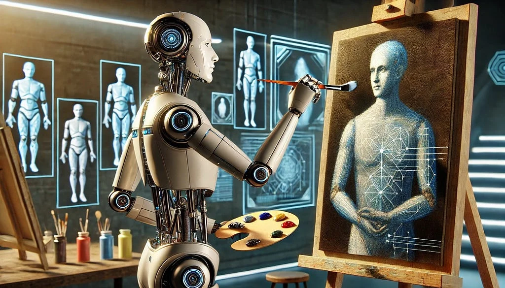
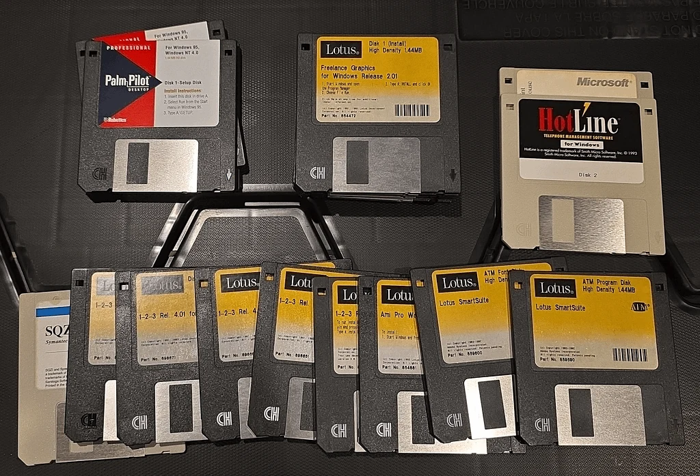
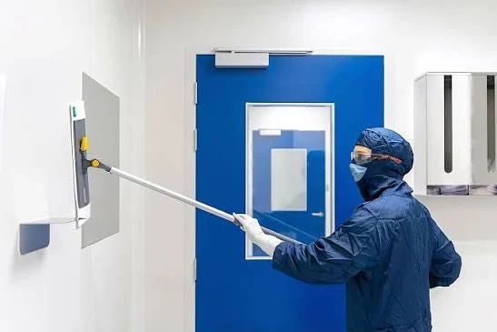
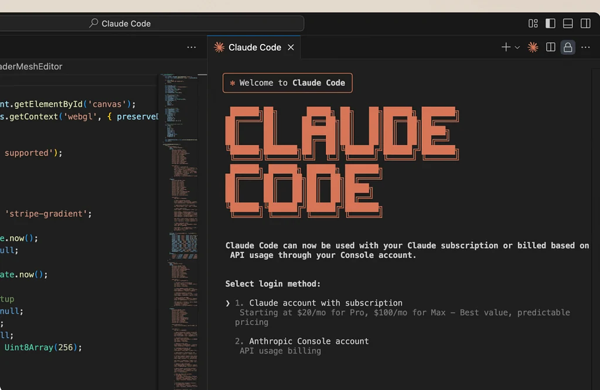
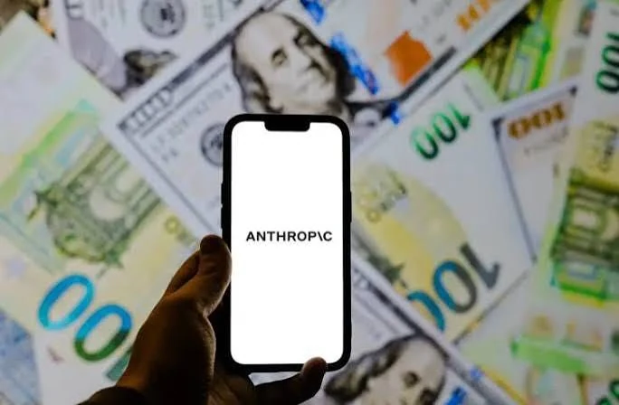
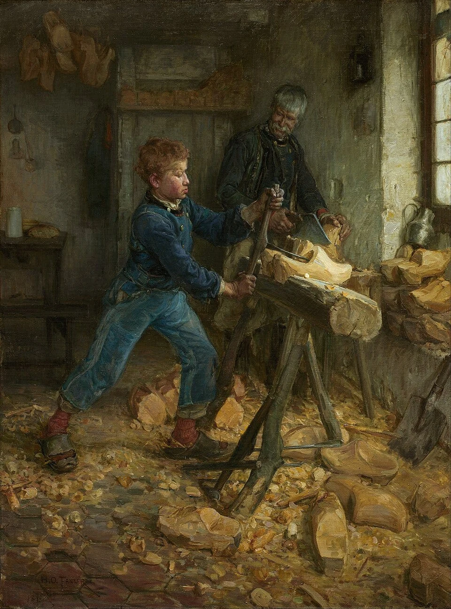
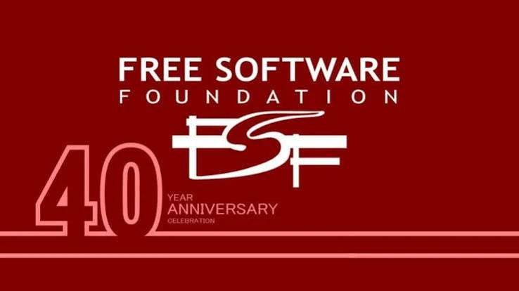
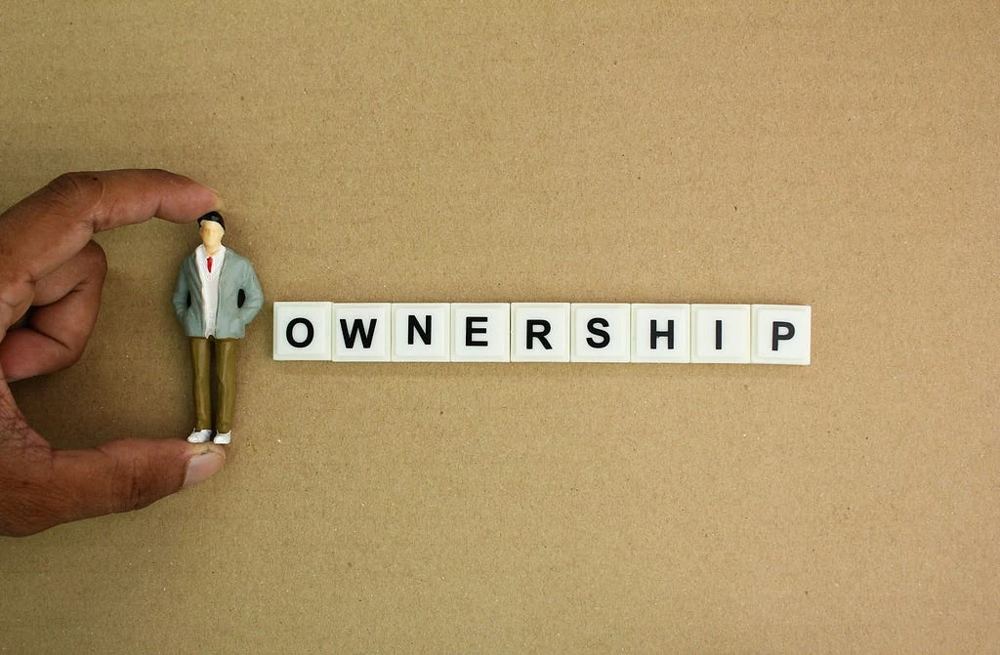

<figure></figure>

<em>Yazılım üretmek giderek kolaylaşıyor. Peki neden onu kullanmak için her geçen gün daha fazla para ödüyoruz? Ve asıl önemlisi, makineler bizim yerimize çalışmaya başladığında ürettikleri değer kime ait olacak?</em>

Geçtiğimiz günlerde programlama dillerinin nasıl ortaya çıktığı üzerine bir yazı yazmıştım. O yazılar bir yazı dizisine dönecek, ama o yazıya başlarken de yapay zekânın gelişiminin üzerimde bıraktığı etkilerden dolayı bir süredir yazı yazmaktan pek keyif alamadığımı söylemiştim. Aslında bu durumun yalnızca yazmakla ilgili olmadığını fark ediyorum. İnsan yıllarca bir şey öğrenmek, bir şey inşa etmek için uğraşıyor. Sonra bir sabah uyanıp o yıllarca öğrendiği şeylerin bir kısmını artık bir makineye birkaç cümleyle yaptırabildiğini görüyor.

Buna sevinmek mi gerekiyor, üzülmek mi, açıkçası emin değilim.

Tam da bu düşünceler içerisindeyken <a href="https://occupysaas.com/">OccupySaaS</a> isimli bir harekete denk geldim. Sitelerinin en tepesinde şöyle yazıyor:

<strong>“They laid us off. We’re rebuilding their SaaS.”</strong>

Yani kabaca, “Bizi işten çıkardılar. Biz de onların SaaS ürünlerini yeniden yapıyoruz.”

İlk bakışta biraz öfkeli bir grup yazılımcının büyük teknoloji şirketlerine kafa tutma girişimi gibi görünüyor. Ki aslında öyle. Kim derdi ki beyaz yakalı işçilerin en burjuvatiklerinin kazan kaldıracağını diye düşünüyordum… Ama siteyi biraz kurcaladığımda, ortada yalnızca birkaç açık kaynak projesinden daha fazlası olabileceğini düşündüm. Ve biraz alaycı gözle baktığım bu elitlerin aslında bir devrimi ateşleyebileceği ihtimalini düşünmeye başladım.

Neden diye soracak olursanız, bu girişim, yapay zekâ konusunda uzun zamandır kafamı kurcalayan bir sorunun küçük ama oldukça somut bir örneği:

<strong>Üretim araçları değişirken üretimin mülkiyeti neden değişmiyor?</strong>

Belki çok büyük işler yapacaklar, belki de yazılım evreninde bu girişimin bir etkisi olmayacak. Ancak ne olursa olsun, bu organizasyon Geçtiğimiz günlerde Evrim Ağacı’nın <em>Yapay Genel Zeka Geldiğinde Sen Ne Yapacaksın?</em> başlıklı videosu da beni benzer bir soruya götürmüştü. Onun da linkini aşağıya bırakıyorum:

<a href="https://www.youtube.com/watch?v=Ec9jyLqYpxg">Yapay Genel Zeka Geldiğinde Sen Ne Yapacaksın? — Evrim Ağacı (YouTube)</a>

Gelecekte insanların yapabildiği işlerin büyük bölümünü makineler yapabiliyorsa, insanların ekonomik hayattaki yeri ne olacak?

Bu sorunun cevabını yalnızca teknolojinin gelişme hızında aramak bana eksik geliyor. Biraz tarihe, biraz ekonomiye, biraz da bilgisayar biliminin kendisine bakmak gerekiyor. İşte bunu yazmak için buraya geldim.

Neyse, yine Nuh-u Nebi’den başlamadan önce SaaS ile başlayalım.

<h2>Bir Yazılım Nasıl Gayrimenkule Dönüştü?</h2>

Yazılım endüstrisinin ilginç bir dönüşümü var.

<figure><figcaption>Eskilerin gözü yaşlı</figcaption></figure>

Bir zamanlar yazılımlar fiziksel kutularda, floppy disklerde satılıyordu. Programı satın alıyor, bilgisayarınıza kuruyor ve kullanıyordunuz. Elbette lisans kısıtlamaları, sürüm yükseltme ücretleri ve üreticinin koyduğu türlü kurallar yine vardı. Ama en azından programın çalıştırılması çoğunlukla kendi bilgisayarınızda gerçekleşiyordu. Zamanla Floppy disklerin yerini CD’ler aldı. Ama onların ömürleri de pek uzun olmadı.

İnternet bağlantılarının yaygınlaşması ve bulut bilişimin gelişmesiyle beraber <strong>Software as a Service</strong>, yani SaaS modeli hayatımızın merkezine yerleşti. Artık yazılımları satın almak yerine onlara erişim hakkı kiralamaya başladık. Hatta bunun en büyük örneği de Steam. Evet oyun sektörü SaaS’ın en hızlı geliştiği yerlerden birisiydi.

<figure></figure>

Buna çok da şaşırmak lazım. Bir oyun aldığınızda Steam’den tek seferde alıyordunuz. Tekrar tekrar CD almaya, her format attığınızda o diskleri arayıp bulmaya çalışma derdiniz yok. Güncellemeler otomatik yapılıyor, farklı cihazlardan aynı verilere ulaşabiliyorsunuz. Ne kadar güzel öyle değil mi? Oyuncu olarak öyle peki işletmeler? Düşünün ki bu yapı sayesinde küçük bir işletmenin daha önce ancak büyük şirketlerin karşılayabildiği sistemleri kendi ihtiyaçlarına göre kullanabilmesi mümkün hâle geldi ki bunun da en büyük örneklerinden birisi SAP. Devasa bir yazılımı almak yerine iş paketlerini kendi ihtiyacınıza göre parça parça satın alıyor, sonra oturup bunların tek bir servisten yüklenmesini bekliyorsunuz. Ne devasa disk yığınları ile uğraşmak zorunda kalıyorsunuz, ne tüm yazılıma para vermek zorunda kalmıyorsunuz.

Buraya kadar gayet güzel.

Fakat zaman içerisinde erişim kolaylığının başka bir özelliği daha ortaya çıktı: <strong>Bağımlılık.</strong>

Örneğin küçük bir işletme kurduğunuzu düşünün. Beş kişilik bir ekibiniz var. Müşterilerinizi yönetmek için bir CRM, belgeleriniz için başka bir servis, ekip içi haberleşme için ayrı bir uygulama, kimlik doğrulama için de başka bir altyapı kullanıyorsunuz.

İşler büyüyor. Beş kişilik ekip on beş kişi oluyor.

Normalde insan şöyle düşünür: Bu yazılımın geliştirme maliyeti çoktan karşılanmış, yeni bir kullanıcı eklemenin marjinal maliyeti de bazı hizmetlerde oldukça düşük. O hâlde yazılım büyüdükçe kullanıcı başına maliyetin azalması beklenebilir.

Ama her SaaS böyle fiyatlanmıyor. On beş kişi olduğunuzda faturanız da üç katına çıkabiliyor. Tabii burada önemli bir ayrım yapmak gerekiyor. Bir yazılımın maliyeti yalnızca CPU zamanı veya RAM tüketiminden ibaret değil. Teknik destek, güvenlik, mevzuata uyum, veri saklama ve sürekli geliştirme de para tutuyor. Dolayısıyla kullanıcı başına ücretlendirme başlı başına bir dolandırıcılık modeli değil.

Ancak fiyatlandırmanın sağlanan hizmetten ziyade <strong>müşterinin sistemden çıkamama kapasitesine</strong> dayanmaya başladığı noktada işin rengi değişiyor.

Müşteri kayıtlarınız, otomasyonlarınız, iş süreçleriniz, üçüncü taraf entegrasyonlarınız ve çalışanlarınızın alışkanlıkları artık o platforma göre şekillenmiş durumda. Başka bir sisteme geçmek isteseniz bile bunun ciddi bir maliyeti var. İşte <em>vendor lock-in</em> denilen şey tam olarak bu.

Yıllarca şirketinizin süreçlerini bir yazılımın içerisinde inşa ediyorsunuz. Bir süre sonra o yazılım sizin çalışma biçiminizi belirlemeye başlıyor.

Hatta öyle bir noktaya geliyor ki, kendi verinizi başka bir yere taşımak bile ayrı bir mühendislik projesine dönüşüyor.

<strong>Eskiden yazılımı çalıştırmak için bilgisayar satın alıyorduk. Bugün bilgisayarı çalıştıran yazılıma erişebilmek için sürekli kira ödüyoruz.</strong>

Bana sorarsanız OccupySaaS’in itiraz ettiği temel mesele de bu.

<h2>1983'ten 2026'ya: Yeni Bir Özgür Yazılım Hareketi mi?</h2>

Bu tartışmanın yeni olduğunu söylemek haksızlık olur.

<figure></figure>

1983 yılında Richard Stallman, GNU projesini duyururken Unix ile uyumlu, insanların özgürce kullanabileceği ve değiştirebileceği bir işletim sistemi geliştirmeyi öneriyordu.

Dikkat edin, konu yalnızca ücretsiz yazılım değildi, özgür yazılımdı.

Yazılımın nasıl çalıştığını inceleyebilmek, onu değiştirebilmek, başkalarıyla paylaşabilmek ve kendi ihtiyaçlarınıza göre geliştirebilmekti.

Çünkü bir yazılımın kaynak koduna erişemiyorsanız, o yazılımın sizin bilgisayarınızda ne yaptığı üzerindeki kontrolünüz de sınırlı kalıyor.

Yıllar içerisinde GNU, Linux ve sayısız açık kaynak projesi bu düşüncenin yalnızca romantik bir mühendislik hayali olmadığını gösterdi. Bugün internette çalışan sunuculardan kullandığımız programlama dillerinin altyapısına kadar sayısız sistem bu kültürün üzerinde yükseliyor.

Fakat aradan geçen kırk yılı aşkın sürede ilginç bir durum ortaya çıktı.

Açık kaynak yazılımların sağladığı altyapıdan yararlanan şirketler, bu altyapı üzerinde geliştirdikleri hizmetleri devasa ticari platformlara dönüştürdüler.

Burada tek başına bir çelişki yok. Açık kaynak yazılımların ticari olarak kullanılması zaten birçok lisansın açıkça izin verdiği bir şey.

Asıl tartışma, bu platformların zaman içerisinde kullanıcıların başka sistemlere geçişini ne kadar zorlaştırdığı.

2011 yılında ortaya çıkan Occupy Wall Street hareketi ekonomik eşitsizlikleri yüzde 1 ve yüzde 99 üzerinden tartışıyordu.

OccupySaaS ise 2026 yılında benzer bir dili yazılım sektörüne taşıyor.

Bir tarafta yazılımı üreten, bakımını yapan, geliştiren mühendisler var. Diğer tarafta ise yazılımın erişimini, dağıtımını ve ticari değerini kontrol eden kuruluşlar.

OccupySaaS’in iddiası şu: Madem bu sistemleri geliştiren insanlar işten çıkarılıyor ve yapay zekâ yazılım üretim maliyetini düşürüyor, o hâlde mevcut platformlarla uyumlu açık kaynak alternatifleri neden kendimiz geliştirmiyoruz?

Bir anlamda 1983'teki özgür yazılım düşüncesi, 2026'nın yapay zekâ araçlarıyla yeniden yorumlanıyor.

Ama bu defa yalnızca özgür bir işletim sistemi değil, şirketlerin her ay fatura ödediği ticari hizmetler hedef alınıyor.

Ve bence işin teknik olarak en ilginç tarafı burada başlıyor.

<h2>Kaynak Kodunu Almadan Aynı Yazılımı Yapmak</h2>

OccupySaaS’in yaklaşımı <em>clean-room implementation</em> olarak bilinen yönteme dayanıyor.

<figure></figure>

Bu yöntemde başka bir yazılımın özel kaynak kodunu kopyalamak veya tersine mühendislik yoluyla iç yapısını çıkarmak yerine, kamuya açık teknik belgelerden ve standartlardan yararlanarak bağımsız bir uygulama geliştiriyorsunuz. Hali hazırda iki tane de projeleri var onlardan da bahsedeceğim.

Bu projedeki amaç aynı iç mimariyi üretmek değil, belirlenen dış davranışlarla uyumlu bir sistem oluşturmak.

Örneğin OAuth 2.0 ve OpenID Connect gibi standartları düşünelim.

Bir uygulama kullanıcının kimliğini doğrulamak istediğinde bir yetkilendirme sunucusuna yönlenir. Sunucu kullanıcıyı doğrular, belirli protokol kurallarına göre yetkilendirme kodları veya token’lar üretir. Uygulama da bunların geçerliliğini kontrol ederek kullanıcıya erişim sağlar.

Bu işlemin arkasında çalışan sistemin mutlaka belirli bir şirkete ait olması gerekmez. Önemli olan protokolün ve uygulamanın beklediği davranışların doğru uygulanmasıdır. OccupySaaS’in ilk projelerinden <a href="https://github.com/occupysaas/zeroauthy">ZeroAuthy</a> tam da bunun üzerine kuruluyor.

Proje, Auth0 ile uyumlu bir kimlik doğrulama sunucusu geliştirmeye çalışıyor. Hedef, mevcut Auth0 SDK’larını kullanan uygulamaların mümkün olduğunca kod değişikliği yapmadan farklı bir sunucuya bağlanabilmesi. Teoride çok güçlü bir fikir. Çünkü burada özgürlük yalnızca kaynak kodunun açık olmasından gelmiyor. <strong>Mevcut sistemden ayrılmanın maliyetinin düşürülmesinden geliyor.</strong>

Ancak işin bir de görünmeyen tarafı var. İki sistemin aynı HTTP endpoint’lerine sahip olması, tamamen uyumlu oldukları anlamına gelmez. Token sürelerinin yönetimi, refresh token rotasyonu, hata cevapları, rate limiting, kullanıcı oturumlarının sonlandırılması, çok kiracılı mimarilerde veri izolasyonu ve özellikle güvenlik sınırları da aynı beklentileri karşılamalıdır.

Bir authentication sisteminde 200 OK dönen bir endpoint görmek sistemin güvenli olduğunu kanıtlamaz. Yanlış yapılandırılmış bir JWT doğrulaması veya hatalı tenant izolasyonu, bütün sistemi saldırıya açık hâle getirebilir.

Nitekim ZeroAuthy henüz erken aşamada olduğunu belirtiyor. Yine de kamuya açık testler, uyumluluk çalışmaları ve OpenID Connect sertifikasyonuna ilişkin belgeler projenin yalnızca bir arayüz taklidinden ibaret olmadığını gösteriyor.

İkinci proje <a href="https://github.com/occupysaas/salescompel">SalesCompel</a>. Bu sefer hedef Salesforce. CRM geliştirmiş birisi olarak söyleyebilirim ki burası biraz daha çetrefilli. Bir müşterinin adını, telefonunu ve e-posta adresini PostgreSQL’e kaydetmek işin kolay tarafı. Müşterilere ait yetkileri, dinamik veri modellerini, satış süreçlerini, otomasyonları, entegrasyonları, işlem bütünlüğünü ve veri taşımayı yıllarca sorunsuz çalıştırmak ise bambaşka bir mesele.

Bir CRM sistemini yalnızca CRUD işlemlerinden ibaret görmek, otomobili dört tekerlekle bir direksiyondan ibaret görmek gibi. SalesCompel’in kendi yol haritasında da tam uyumluluğun henüz sağlanmadığı, veri migrasyonu, güvenlik, otomasyon ve üretim ortamı doğrulamalarının önemli ölçüde tamamlanmayı beklediği açıkça görülüyor. Yani ortada yarın sabah Salesforce aboneliğini iptal ettirecek olgunlukta bir sistem yok.

Ama amaç da yalnızca bugünkü iki projeyi değerlendirmek değil. Çünkü asıl değişen şey bu tip sistemleri geliştirebilmek için gereken <strong>insan emeğinin niteliği ve maliyeti</strong>.

<h2>Yapay Zekâ: İşsizliğimizin Sebebi mi, Kurtuluşumuzun Aracı mı?</h2>

<figure></figure>

OccupySaaS’in en tartışmalı ve beynimi gıdıklayan tarafına geldik.

Hareket, işten çıkarılan mühendislerin yapay zekâ ajanlarıyla büyük teknoloji şirketlerinin ürünlerini yeniden oluşturmasını öneriyor.

<strong>Bir dakika.</strong>

Yapay zekâ nedeniyle işini kaybettiğini düşünen mühendisler, yapay zekâyı kullanarak kendilerini işten çıkaran şirketlerle rekabet edecekler(?).

Kulağa biraz trajikomik geliyor, değil mi?

Üstelik teknoloji sektöründeki bütün işten çıkarmaları yapay zekâya bağlamak da doğru değil. Faiz oranları, pandemi sonrası aşırı işe alımların düzeltilmesi, şirketlerin maliyet politikaları ve değişen yatırım koşulları da bu sürecin parçası. Ama burada daha temel bir dönüşüm var. Yapay zekâ, özellikle yazılım üretiminin bazı aşamalarında insanın harcaması gereken zamanı ciddi biçimde azaltabiliyor.

Eskiden bir geliştiricinin günlerini alacak sıradan bir REST API, veri modeli veya yönetim arayüzü bugün yapay zekâ araçlarıyla çok daha kısa sürede hazırlanabiliyor. Fakat günlerce süren bir işi birkaç dakikada kod hâline getirebilmek, o kodun yıllarca güvenilir biçimde çalışacağını garanti etmiyor.

<blockquote>Çünkü kod yazmak ile mühendislik yapmak aynı şey değil.</blockquote>

Bunun üzerinde özellikle durmak istiyorum. Üretilen yazılımın güvenliğini doğrulamak, veri kaybına karşı önlem almak, hatalı durumları ele almak, tutarlılığı korumak ve beklenmedik yüklerde sistemi ayakta tutmak hâlâ ciddi bir mühendislik faaliyeti.

Yapay zekâ bu işlerin bir bölümünde de giderek daha fazla rol oynayabilir. Ancak bugün bir modelin çok hızlı kod üretmesiyle bir sistemin güvenilirliğinin kanıtlanması arasında büyük bir boşluk bulunuyor. OccupySaaS bu boşluğu teknik sözleşmeler, açık spesifikasyonlar, uyumluluk testleri ve insan incelemesiyle kapatmayı hedefliyor.

Bence bu hareketi önemli kılan da bu.

Yapay zekâya “Bana Salesforce yaz” demek yerine, test edilebilir davranışları tarif edip bunları karşılayan bir sistemi parça parça geliştirmeyi öneriyorlar. Böylece yazılım mühendisliğinin önemli bir bölümü, doğrudan kod yazmaktan <strong>kodun ne yapması gerektiğini tanımlama ve gerçekten onu yapıp yapmadığını ispatlama</strong> işine doğru kayıyor.

<figure></figure>

Geçen yazımda programlama dillerini anlatırken sürekli döndüğüm bir düşünce vardı: Karmaşıklık yok olmaz, yer değiştirir. Burada da olan biraz bu. Kod yazmanın maliyetini düşürüyorsunuz. Ama sistemin davranışını doğru tanımlamanın, üretilen kodu doğrulamanın ve uzun süre bakımını yapmanın maliyeti ortadan kaybolmuyor. Yalnızca başka katmanlara taşınıyor.

Dolayısıyla yapay zekâ sayesinde yazılım geliştirmenin ucuzlaması, yazılım mühendisliğinin tamamen ortadan kalkması demek değil. Ama şirketlerin aynı miktarda yazılım üretebilmek için daha az çalışana ihtiyaç duyması ihtimali de göz ardı edilemez.

Peki bu verimlilik artışından kim yararlanacak?

İşte beni ilgilendiren soru bu.

<h2>Makineler Çalışırken Sermayenin Sahibi Kim Olacak?</h2>

<figure></figure>

Şimdi gel gelelim Yapay Genel Zeka (AGI) geldiğinde neler olacağına.

Bu konunun beni düşündüren tarafı AGI’nin tam olarak ne zaman geliştirileceği veya nelere kadir olacağı değildi.

Bir gün insanın yapabildiği ekonomik faaliyetlerin önemli bir bölümünün otomatikleştirilebildiği bir dünyaya ulaşırsak, insanın o ekonomide nasıl konumlanacağıydı.

Bir fabrikanız olduğunu düşünün. Eskiden yüz işçi çalıştırıyordunuz. Yeni otomasyon sistemleriyle aynı üretimi on işçiyle gerçekleştirebilir hâle geldiniz. Üretiminiz aynı kaldı, hatta arttı. Ekonomik açıdan baktığınızda verimlilik artışı muazzam.

Ama geriye kalan doksan kişinin gelirini nasıl elde edeceği ayrı bir sorun. Bu sorun bir zamanlar Karl Marx’ın kafasını kurcalayan bir soruydu ve bu soru Das Capital’i yazdırdı.

Şimdi bu senaryoyu yalnızca bir fabrikaya değil, yazılım şirketlerine, lojistiğe, finans sektörüne, tasarıma, muhasebeye ve zamanla daha fazla alana uygulayın. Elbette tarih boyunca otomasyon yeni meslekler de yarattı. İnsanlar tarımdan sanayiye, sanayiden hizmet sektörüne geçtiler. Teknolojik gelişmelerin her zaman kalıcı kitlesel işsizlik doğuracağı söylenemez.

Fakat genel amaçlı yapay zekâ varsayımını farklı kılan şey, yalnızca belirli görevlerin değil, yeni ortaya çıkan işlerin de otomatikleştirilebilme ihtimalidir.

Bu senaryonun gerçekleşip gerçekleşmeyeceğini henüz bilmiyoruz.

Yine de gerçekleşme ihtimalini ciddiye alıyorsak, ekonomik düzenin aynı kalacağını varsaymak biraz tuhaf. Çünkü bugünkü sistemde insanların büyük bölümü gelirini <strong>emeklerini satarak</strong> elde ediyor. Fabrikanın sahibi makineye sahiptir. İşçi ise emeğine. Üretim süreci giderek daha az insan emeğine ihtiyaç duyarsa, emeğini satarak geçinen kişinin pazarlık gücü ne olacak?

Daha da önemlisi, otomasyonun yarattığı ek değer kime ait olacak? Bir yazılımcının geliştirdiği sistem milyonlarca insan tarafından kullanılabilir. Fakat o sistemin mülkiyeti, dağıtımı ve gelir modeli çoğunlukla yazılımcının kendisinde değildir.

Şimdi düşünün.

Bir mühendis yıllarca bir SaaS platformunun geliştirilmesinde çalışıyor. Platform zaman içerisinde devasa bir ekonomik değere ulaşıyor. Daha sonra şirket yeni otomasyon araçları kullanarak daha az mühendise ihtiyaç duyduğuna karar veriyor. Mühendis işini kaybediyor. Ama geliştirilmesine katkıda bulunduğu sistem çalışmaya ve para kazandırmaya devam ediyor.

Burada tek başına hukuki bir haksızlık olduğunu söyleyemeyiz. Şirket ile çalışan arasındaki mülkiyet ve ücret ilişkisi sözleşmelerle belirleniyor. Yazdığın kodun şirkete ait olduğunu kabul ederek giriyorsun ve karşılığında aylık bir ücret alıyorsun. Aynı ayakkabı fabrikasında çalışan insanların ürettikleri ayakkabılara değil de ay sonunda yatan maaşa sahip olması gibi. Tabi buradaki ayakkabıdan her atılan adım için para kazanmaları, ve yeni ayakkabı üretmesen bile çarkların dönebiliyor olması itibariyle SaaS geliştiricisi olmakla ayakkabı işçi olmak arasında dağlar kadar fark var.

<figure><figcaption>Neden ayakkabı işçisi örneği verdiğimi Sabot’u bilenler anlamıştır diye umut ediyorum</figcaption></figure>

Fakat ekonomik ve toplumsal açıdan başka bir soru sormamız gerekiyor:

<strong>İnsan emeğinin yarattığı birikim, insan emeğine daha az ihtiyaç duymaya başladığında o birikimin getirisi nasıl paylaşılacak?</strong>

Maalesef ki OccupySaaS bu soruya bütün ekonomiyi yeniden tasarlayacak bir cevap vermiyor. Daha çok “YUUUUH” diyerek eylem yapmak gibi bir şey yaptığı.

Ama oldukça ilginç bir tepki ortaya koyuyor.

Madem mevcut üretim araçları üzerinde mülkiyetimiz yok, o hâlde alternatif üretim araçlarını ortaklaşa inşa edelim.

Bu, bir SaaS şirketiyle yalnızca fiyat üzerinden rekabet etmekten daha farklı bir düşünce.

<h2>Açık Kaynak Gerçekten Bir Çıkış Yolu mu?</h2>

<figure></figure>

Burada biraz eleştirel olmak gerekiyor.

Açık kaynak kodun varlığı, ekonomik gücün otomatik olarak demokratik biçimde dağıtılması anlamına gelmez.

Bir yazılımın GitHub’da bulunması ve Apache 2.0 lisansıyla yayımlanması, herkesin o yazılımdan aynı ekonomik faydayı sağlayacağı anlamına gelmiyor. Sonuçta kaynak koduna erişmek başka, onu güvenilir ve ölçeklenebilir biçimde çalıştırabilecek kaynaklara sahip olmak başka.

Örneğin bir SaaS hizmetini kendiniz barındırmaya karar verdiniz. Abonelik ücretinden kurtulabilirsiniz. Ama sunuculara, yedekleme sistemlerine, ağ güvenliğine, izleme altyapısına, güncellemelere ve gerektiğinde müdahale edecek insanlara yine ihtiyacınız olacak. Hatta bazen bütün bunları kendiniz yönetmek, ticari bir hizmete abonelik satın almaktan daha pahalıya gelebilir. Bir CRM sunucusunu Docker konteynerinde ayağa kaldırmakla onu müşterilerinizin verilerini kaybetmeden beş yıl işletmek aynı şey değil.

Bir de işin daha derin bir tarafı var. Apache 2.0 gibi izin verici lisanslar, kodun ticari olarak kullanılmasına ve belirli koşullar altında kapalı kaynak ürünlerin parçası hâline getirilmesine izin veriyor. Yani OccupySaaS’in ürettiği bir projeyi yarın başka bir şirket alıp kendi ticari hizmetinin altyapısında kullanabilir. Bu, lisansın sağladığı özgürlüğün bir sonucu. Ancak bunu düşünürken kendini yiyen yılan canlandı gözümde.

Ama hareketin ekonomik güç yoğunlaşmasına karşı geliştirdiği argüman açısından da tartışılması gereken bir konu.

Daha önemlisi, açık kaynak projelerinin uzun vadeli sürdürülebilirliği meselesi var. Yazılımı geliştiren insanlar kim olacak? Güvenlik açıklarına kim müdahale edecek? Bir projeye yüzlerce kişinin katkıda bulunması güzel. Ancak beş yıl sonra kritik bir veri tabanı hatası ortaya çıktığında sorumluluğun kimde olduğu da belirlenmeli.

Bunlar çözülemeyecek meseleler değil. Fakat özgür yazılımın başarısını yalnızca GitHub yıldızlarıyla veya üretilen kod satırıyla ölçmek de doğru değil.

Belki de yapay zekânın bu alanda getireceği en önemli dönüşüm, küçük ekiplerin daha önce büyük şirketlerin gerçekleştirebildiği projeleri geliştirebilmesi olacak. Ancak bunun gerçek bir alternatif oluşturabilmesi için kod üretiminin yanında finansman, yönetişim, güvenlik ve bakım modellerinin de gelişmesi gerekiyor.

<strong>Yazılımın kaynak kodunu özgürleştirmek, onu çalıştırabilecek gücü özgürleştirmekle aynı şey değil.</strong>

Ve bir kez daha aynı soruya dönüyoruz: Üretimin kontrolü kimde?

<h2>Belki de Asıl Devrim Yeni Bir Yazılım Yazmak Değildir</h2>

OccupySaaS’in başarılı olup olmayacağını bilmiyorum. Belki birkaç yıl içerisinde gerçekten büyük SaaS platformlarına alternatif olabilecek projeler ortaya çıkaracaklar. Belki de projelerinin bir kısmı geliştirici topluluğunun ilgisini kaybederek terk edilecek.

Bunların ikisi de mümkün. Ama bu girişimin bence önemli bir tarafı var.İlk defa büyük teknoloji şirketlerinin sunduğu bazı hizmetlerin yeniden geliştirilemeyecek kadar karmaşık olduğu varsayımı daha ciddi biçimde sorgulanıyor.

Elbette mevcut sistemleri yeniden üretmek her zaman mantıklı değil. Bir sistemi sıfırdan geliştirmek, mevcut ve olgun bir açık kaynak alternatifi kullanmaktan daha maliyetli de olabilir. Yine de yapay zekânın kod üretimini hızlandırması, bazı yazılım pazarlarında rekabetin önündeki teknik engelleri aşağı çekeceği aşikar. Bu da mevcut şirketlerin fiyatlandırma ve kullanıcı bağımlılığı üzerinden kurdukları ekonomik avantajların bir bölümünü zayıflatabilir.

Ancak burada bir ironi daha var. OccupySaaS’in açık kaynak alternatifleri üretmek için kullandığı yapay zekâ modellerinin bir bölümü de büyük teknoloji şirketlerinin altyapılarına bağımlı. Yani SaaS tekellerine karşı alternatif yazılım üretirken bu defa yapay zekâ sağlayıcılarına bağımlı hâle gelebilirsiniz.

Bir bağımlılığı ortadan kaldırırken başka bir bağımlılık yaratmak mümkün. O nedenle meselenin yalnızca SaaS hizmetlerini açık kaynakla değiştirmek olduğunu düşünmüyorum. Uzun vadede hesaplama gücünün, modellerin, veri merkezlerinin, yazılım altyapılarının ve bunlardan doğan ekonomik değerin kim tarafından kontrol edildiğini de tartışmamız gerekiyor.

Yapay zekâ insanların üretkenliğini artıracaksa bu çok iyi. Daha önce on kişinin yapabildiği işi bir kişi gerçekleştirebilecekse, daha az kaynakla daha fazla şey üretebileceksek, insanlığın bundan fayda görmemesi için bir sebep yok.

Ama üretkenlik artışı ile refahın paylaşılması aynı şey değil.

Bir teknoloji çok büyük bir ekonomik değer oluşturabilir. Bu değerin toplumun geniş kesimlerine yayılıp yayılmayacağı ise yalnızca teknolojik kapasiteyle değil, kurumlarla, rekabetle, mülkiyet ilişkileriyle ve siyasi tercihlerle belirlenir.

Bu yüzden bana sorarsanız asıl soru “Yapay zekâ bütün işleri elimizden alacak mı?” değil.

<strong>Yapay zekâ sayesinde çalışmak zorunda kalmadığımız bir dünya kurabilir miyiz, yoksa çalışabilecek insanlara daha az ihtiyaç duyulan ama geçinmek için çalışmanın hâlâ zorunlu olduğu bir dünyaya mı gideceğiz?</strong>

İkisi birbirinden oldukça farklı. Birinde otomasyon insanları daha özgür kılıyor. Diğerinde ise otomasyonun yarattığı ekonomik avantaj, üretim araçlarına sahip olanların elinde yoğunlaşabiliyor.

Ve OccupySaaS gibi hareketler, belki de bu iki gelecek arasındaki mücadelede küçük çığlıklar gibi duyuluyor olabilir, şimdilik…

<h2>Sonuç Yerine: Kod Kimin, Gelecek Kimin?</h2>

<figure></figure>

Yazılım dünyasında son birkaç yılda yaşanan gelişmelere baktığımda çelişkili duygular yaşıyorum.

Bir taraftan inanılmaz bir heyecan var. Çok daha az kaynakla çok daha karmaşık sistemler geliştirebiliyoruz. Daha önce büyük ekipler gerektiren işlerin bazılarını küçük ekiplerle gerçekleştirmek mümkün oluyor.

Diğer taraftan ise insanın yıllarca emek vererek öğrendiği bir becerinin ekonomik değerinin nasıl değiştiğini izlemesi garip bir duygu.

Belki de asıl rahatsızlık burada.

Yıllardır bilgisayarlara nasıl hesap yapacaklarını anlatıyoruz.

Önce makine dilini kullandık, sonra assembly, bu dönemlere ben yetişemedim ama sonrasında gelen C, C++, Java, Python ve daha nicelerini kullandık, çeşitli araçlar geliştirdik. Her nesilde makinelerle konuşmayı biraz daha kolaylaştırdık.

Şimdi geldiğimiz noktada makineye ne yapmak istediğimizi doğal dille anlatabiliyoruz. Bu, bilgisayar biliminin tarihsel gelişiminin son derece etkileyici bir aşaması.

Fakat bütün bu gelişmelerin sonunda daha az insan emeğiyle daha fazla şey üretebiliyorsak, bunun insanlığa daha fazla zaman ve özgürlük olarak dönmesini beklemek çok mu tuhaf?

OccupySaaS’e baktığımda gördüğüm şey, büyük SaaS şirketlerine öfkelenmiş bir grup mühendisten ibaret değil. Aynı zamanda, teknolojinin yarattığı değerin dağılımına yönelik bir itiraz. Bu itirazın bütün cevaplara sahip olduğunu düşünmüyorum. Hatta mevcut projelerin uzun vadede ne kadar başarılı olabileceği konusunda ciddi soru işaretlerim var.

Ama sorduğu sorunun önemli olduğunu düşünüyorum.Bugün bir SaaS hizmetinin kullanıcı başına ücretine itiraz ediyoruz. Yarın yapay zekâ modellerine erişim için ödeyeceğimiz ücretleri, hesaplama kaynaklarının sahipliğini veya tamamen otomatikleştirilmiş üretim sistemlerinin yarattığı gelirleri tartışıyor olabiliriz.

Belki de özgür yazılım fikrinin yeni dönemde yalnızca kodu değil, o kodu çalıştıran altyapıları ve ekonomik ilişkileri de kapsayacak şekilde yeniden düşünülmesi gerekecek. Sonuçta kendi yazdığımız yazılımın kiracısı olmak istemiyoruz.

Ama daha önemli bir soru var.

<strong>Bir gün makineler bizim yerimize çalışmaya başladığında, o makinelerin sahibi olabilecek miyiz? Yoksa onların ürettiklerini kullanabilmek için de kira mı ödeyeceğiz?</strong>

Sanırım önümüzdeki dönemin en önemli tartışmalarından birisi bu olacak.

Esen kalın.

<em>Not: OccupySaaS projelerinin teknik olgunluğuna ilişkin değerlendirmelerimi bu organizasyonu keşfettiğin, 2 Kasım 2026 itibarıyla Github hesaplarındaki proje belgelerine dayanmakta. Yapay genel zekâya ilişkin bölümler ise kesin gelecek bekletilerim değil daha ziyade tahminlerim, olası ekonomik senaryolarına yorumumdur.</em>

<h2>Kaynakça ve ileri okuma</h2>

<ul><li><a href="https://occupysaas.com/">OccupySaaS - They laid us off. We're rebuilding their SaaS.</a></li><li><a href="https://github.com/occupysaas">Occupy Saas</a></li></ul>
