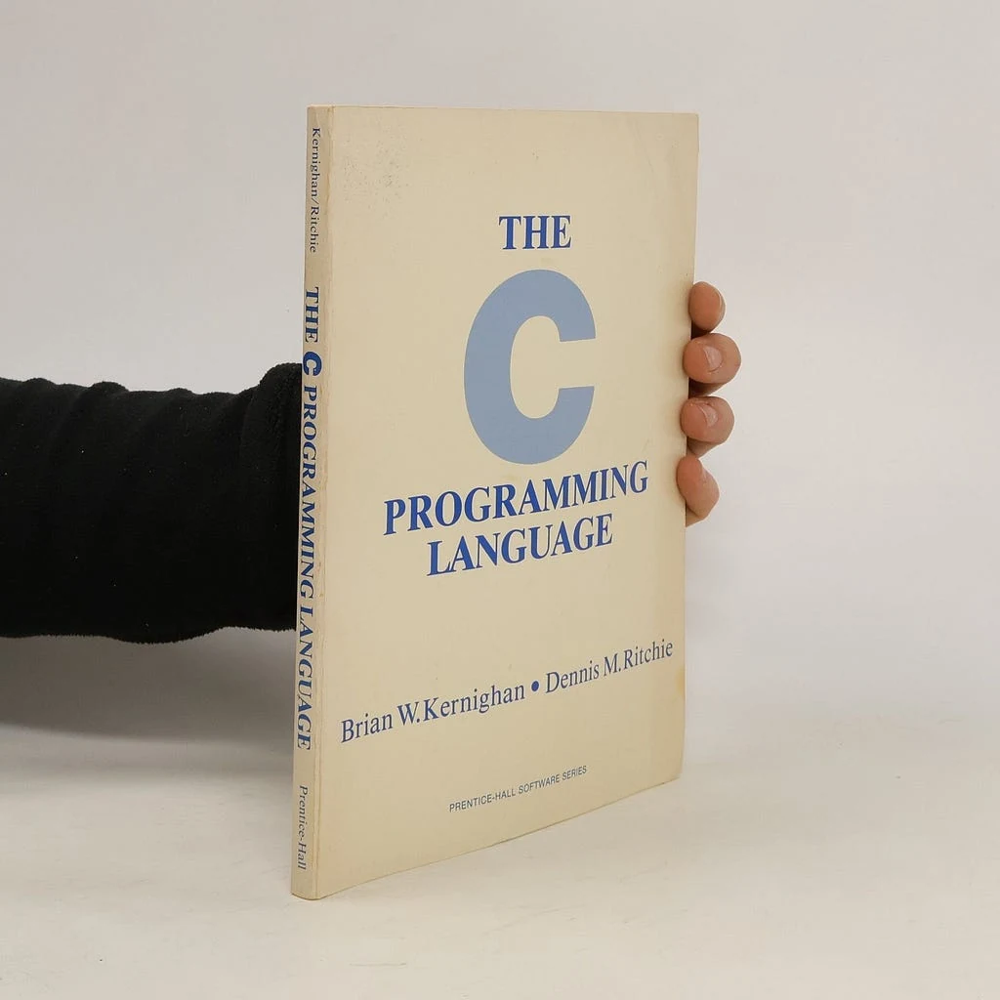
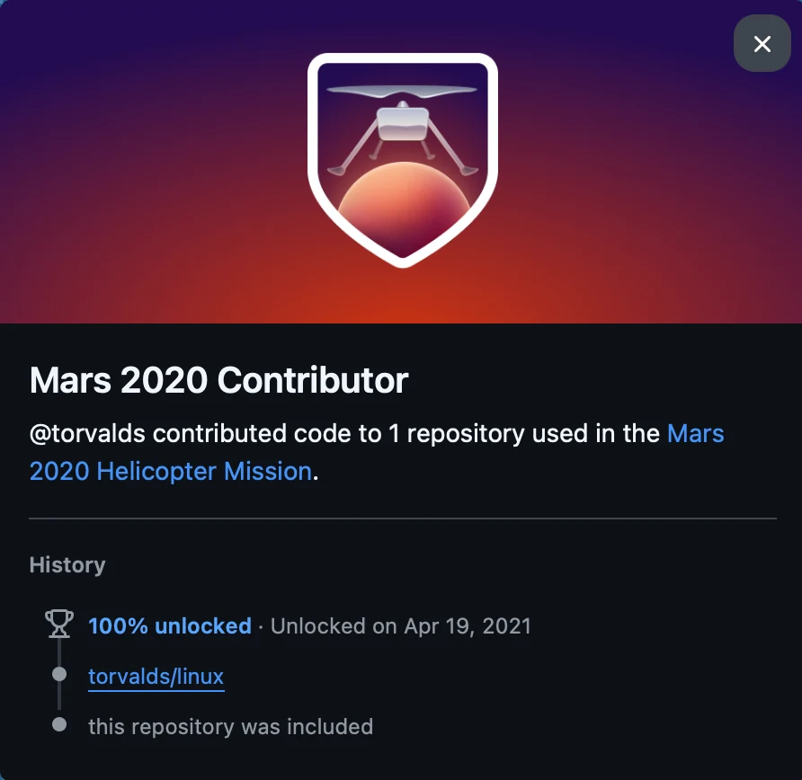
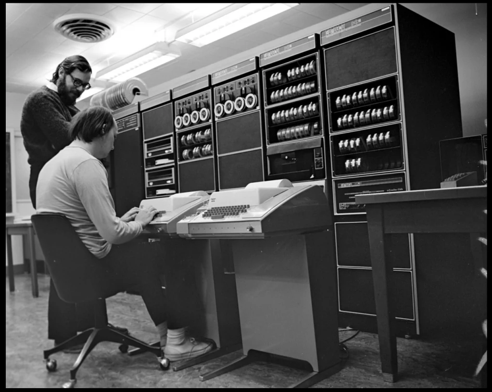
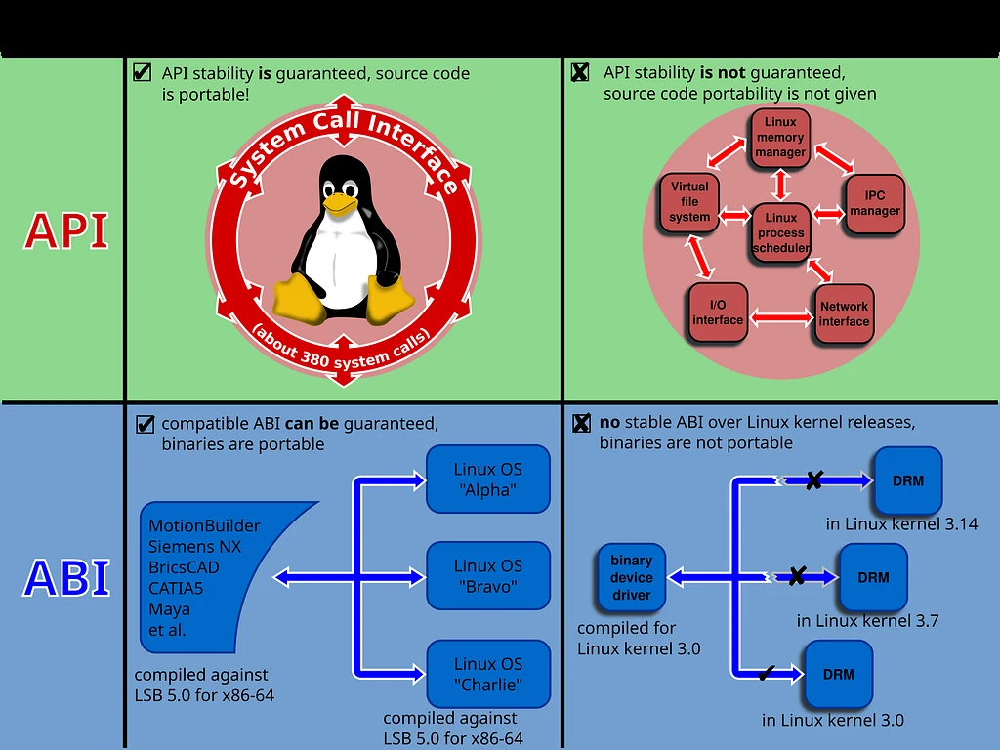
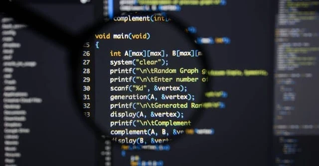
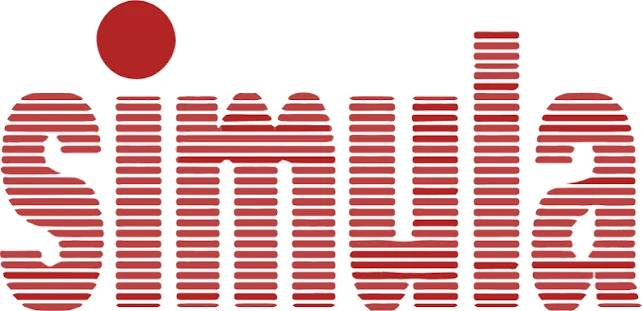

<figure><figcaption>First version of the book on the C language</figcaption></figure>

Those who know my article where I previously killed off Java will know.

<a href="/genel/internet/tabut/">Drive Another Nail into the Coffin of the Fallen</a>

This article won't be along the lines of "oh it died, oh no it didn't." We will discuss why C is always at the top of the language leaderboard despite Rust developers.

<h2><strong>The Illusion Seen from the Outside</strong></h2>

There is a common misconception that beginners in software or those who stay only on the side of the industry dealing with popular web frameworks frequently fall into: they think C is a museum piece from the 1970s that has outlived its expiration date, taught only in universities to torture students. You can even hear people during every coffee break or forum corner going a step further, saying, "Are you still writing C? Does C even have a place when Rust exists?" Well, I have a lot to say to those friends. Anyway…

While in your dreams you're busy with "rustification" of everything, in the real world the situation is completely different. From the OS kernel of the smartphone you pick up when you wake up in the morning (whether it's Android's Linux kernel or iOS's XNU/Darwin), to the Windows NT kernel running when you turn on your PC (I say this because Windows' use of C++ is pretty much an esoteric way of using C), everything breathes with C. Git, where you push your code; the Linux kernel running embedded in every smart device from the Ingenuity helicopter that made 72 flights on Mars to your oven; SQLite, the world's most widely deployed database, embedded inside every Android phone and every iPhone; Redis, racing against microseconds; PostgreSQL, forming the backbone of major banks… Never mind all of those; even the primary interpreter of Python (CPython), which data scientists and AI folks cannot praise enough, was written from top to bottom in C.

<figure></figure>

In other words, from the moment you press a key on your keyboard to a pixel lighting up on your monitor, from downloading a packet from the internet to rendering a web page on screen, in every millisecond that passes, you are actually walking on top of C without even realizing it.

So how is it that a language written half a century ago by two men in the corner of a laboratory using typewriter-like terminals cannot be dethroned despite so many technological revolutions and dozens of modern languages?

<h2><strong>Portable Assembly: Touching Hardware Without Gloves</strong></h2>

The first answer to this question is hidden in C's philosophy—or rather, its lack of philosophy.

At the end of the 1960s, Dennis Ritchie and Ken Thompson hit two different brick walls at Bell Labs. The first was Multics: that massive time-sharing operating system project jointly run by MIT, GE, and Bell Labs, where multiple users could share a computer simultaneously, had become so bloated that Bell Labs pulled out of the project in 1969. Thompson and Ritchie missed that comfortable multi-user environment Multics offered, but they had nothing on hand except a PDP-7 forgotten in a corner. Unix emerged precisely from here, from the question: "Can we fit the good ideas of Multics into a tiny machine?" While trying to write the operating system, they encountered another massive wall. In that era, operating systems were mostly written directly in Assembly (Multics being written in PL/I was a brave exception). But Assembly is tied to the processor; if you wrote the code for a PDP-7, the day you replaced the machine with a PDP-11, you had to scrap the entire operating system and rewrite it from scratch. That is exactly what happened to them: when a PDP-11 replaced the PDP-7, the parts of Unix built up to that point had to be rewritten once again in Assembly. Hardware was evolving rapidly, and writing code from scratch for every new processor was a nightmare.

<figure></figure>

Ritchie and Thompson's genius came into play right at this point. They needed a language close enough to the machine not to lose hardware speed and power, yet simultaneously "portable" enough to run the exact same code when the processor changed simply by swapping its compiler. The B language Thompson derived from BCPL was too primitive for this job: it was typeless and didn't fit the PDP-11's byte addressing. Ritchie added types to B, bringing forth C in 1972; by early 1973, structures (structs) arrived as well, the core of the language was complete, and that summer the Unix kernel was rewritten in C. C was born out of this exact need—that is, in a sense, with the philosophy of "portable Assembly."

The primary reason C remains indispensable even today is that it draws no veil between you and the hardware. When you declare a pointer in C, that pointer is not an abstract object identity or a magic reference; it is a raw address. (In a modern operating system, this is not a physical RAM slot but a number in virtual address space; yet from C's perspective, it makes no difference: it is a number you can do arithmetic on.) When you write a <strong><em>struct</em></strong> in C, that data structure is not scattered around at the compiler's whim; fields settle into memory in the exact order you wrote them, within the boundaries of hardware alignment rules. The only freedom the compiler has is the alignment gaps (padding) it leaves in between, and you can see that with <strong><em>sizeof</em></strong>.

C introduces zero "magic" in between. There is no hidden memory manager, no code snippet running behind your back without your knowledge, no virtual machine. When you look at C code, you can roughly estimate which machine instructions it will translate to on the processor. This transparency is an invaluable superpower for systems programmers who must control every single grain of hardware, from microcontrollers to supercomputers.

<h2><strong>The Latin of the Software World: C ABI</strong></h2>

Yet C's invisible power to the programmer and the second great structure that makes it immortal is the <strong>C ABI (Application Binary Interface).</strong>

<figure></figure>

Although having an abbreviation similar to API, an ABI operates at a relatively lower level of abstraction. Interface compatibility here depends on target hardware and software compilation toolchains. In contrast, an Application Programming Interface (API) defines access at the source code level—a relatively high-level format that is almost completely independent of hardware and readable by humans. While an API defines an interface at source code level before compilation, an ABI defines a machine interface for compiled code. To elaborate slightly on what a machine interface entails, an ABI turns the entire process into an interface: processor instruction set, register file structure, memory access types; primitive data types the processor can directly access, their sizes, memory layouts, how function arguments are handled, how calls and returns are handled, and so on. In other words, when a processor architecture is developed, instead of rewriting all code from scratch, you only define this interface and then recompile all your code from scratch. As a result, your code is ensured to run identically.

Anyway, we dove pretty deep. But it's worth every bit of depth: today the software world is like a massive Tower of Babel. On one side Python, on another Rust, on yet another Go, Swift, C#, and Kotlin… Each of these languages has its own world, its own way of holding objects in memory, and its own runtime logic. For example, Python cannot directly understand Rust's rich enum structures or borrow checker rules. Swift cannot decipher Go's dynamic goroutine stack.

So then, in an artificial intelligence model you write in Python, how do the massive matrix libraries (PyTorch, TensorFlow) written in C++ and CUDA run under the hood? Or how can you call a super-fast algorithm you wrote in Rust from inside Node.js?

The answer, once again, is the C ABI.

When different languages want to talk to each other, cross the border checkpoint, and exchange data, they cannot speak their native tongues. When they arrive at the border crossing, they pull out their passports and are forced to speak the common tongue: C's binary interface standard. When Rust wants to expose a function to the outside world, it says <strong>extern "C"</strong>. Though the Rust community is a bit sensitive, saying, "Bro, we have our own ABI, we don't need C," the reality is that for that function to be invoked, <em>they have to comply with C's rules</em>. That is, so to speak, they "rustify" C's ABI as well, and only after doing that can they speak by setting their own rules.

Python, on the other hand, is at a completely different point: most heavy libraries you import (NumPy, PyTorch…) eventually link to C or C++ code; they do this either via CPython's C extension API or through bridges like <strong><em>ctypes</em></strong>/<strong><em>cffi</em></strong>. The common denominator of all of them is once again C's calling conventions. What about operating systems? Even the system calls (syscalls) they provide are documented with a C interface.

C has become the Latin of the modern software world. Just as all scientists, physicians, and jurists across Europe communicated in Latin for centuries even after the Roman Empire collapsed; today, all programming languages must bow to C's rules in order to communicate with each other and with the operating system. Killing a language is easy, but changing the border protocol that all languages in the world mutually speak is virtually impossible.

So everyone can rest easy: C is immortal and remains one of the most vital building blocks of the software world.

<h2><strong>The Terrifying Bill: A Dangerous Freedom</strong></h2>

<figure></figure>

Everything looks magnificent up to this point, doesn't it? Total dominion over hardware, zero runtime overhead, universal compatibility…

But what did we say in the first article: there is no free lunch... The bill for this unlimited power offered by C is one of the heaviest bills in software history.

While granting you such total command over hardware, C provides you with no seatbelt—and indeed, not providing one is quite sensible given the time it was born or its intended purpose. It expects you to keep entirely in your own head when to free every region you acquire from memory. Forget a <strong><em>free()</em></strong> call, and the system silently leaks memory until the server crashes days later. Accidentally access memory you already released (<em>use-after-free</em>), or attempt to write to the sixth element of a five-element array (<em>buffer overflow</em>), and the compiler will not warn you.

The C compiler assumes you know what you're doing, and writes that byte right there. At runtime, if that location doesn't belong to something else, everything appears to be running smoothly; but if it belongs to something else, woe betide you. The C standard calls this "undefined behavior" and uses the phrase literally: The standard promises no predictable behavioral outcome for that moment. The program might run correctly, crash, silently produce wrong results; the compiler might even optimize away and completely erase that code path under the assumption that "such a thing cannot happen," or worse, if there is a data read or write, it might access data in a completely unrelated memory region and utterly corrupt execution flow. If the developer doesn't map out the scenario flawlessly in their mind and know what to free where and what to write where, they awaken this monster. And undefined behaviors are among the most terrifying monsters in the software world.

The result? Crashing flight control systems, and worst of all, security vulnerabilities that enable remote code execution.

Look at the security reports published by Microsoft and Google today; roughly <strong>70% of vulnerabilities patched by Microsoft since 2006 and severe security bugs in Chromium stem directly from memory safety errors in C and C++</strong>. Things have reached such a point that the White House, NSA, and cybersecurity agencies are openly publishing reports urging the abandonment of languages lacking memory safety (especially C) in critical infrastructure.

C hands you a scalpel to dissect the hardware. With that scalpel you can perform the world's most delicate brain surgery; or in a careless moment, you can sever your own carotid artery. C has zero interest in the difference.

Along with memory safety, there is also the issue of data layout. Above, we noted that "a struct settles into memory in the exact order you wrote it"; the flip side of this transparency is that the layout is entirely your responsibility. If you order fields poorly, your struct bloats due to padding; if you want a cache-friendly layout, you have to build that yourself too; C offers you zero guidance on what to do with which data structure.

And it shouldn't offer guidance—look, I say it again, this is a deliberate design. However, as a consequence of this design, to code correctly in C—in a sense, to have peace of mind—you must be an engineer specialized in memory management and data structure design. Otherwise, performance plummets, bugs multiply, and security vulnerabilities emerge.

In fact, these security vulnerabilities aren't the only problem; there is an underlying memory and management crisis. And behind that lies an even greater bottleneck: as software expanded, codebases turned into massive spaghetti where boundless global state and heaps of functions tangled into one another. The human mind could no longer track thousands of lines of procedural code and what data was changing where in memory.

<figure></figure>

It was out of this very helplessness that the famous idea sprouted at the end of the 1960s with Simula, whose philosophy Alan Kay subsequently grounded with Smalltalk, inspired by biological cells: <em>"Instead of viewing software as disjointed functions and raw data blocks, what if we design it as independent 'objects' that encapsulate their own state, protect themselves from the outside world, and communicate with one another?"</em> The idea of encapsulating data and the functions that manipulate that data into the same capsule was seen as the sole savior from the growing software crisis. Now everyone believed they could model the real world one-to-one in code.

<h2><strong>What's Next?</strong></h2>

Right at this juncture, in 1979, a Danish computer scientist who had newly joined Bell Labs, Bjarne Stroustrup, posed this question:

<em>"What if we retain C's proximity to hardware, its speed, and its zero-cost abstraction capability, but add classes, objects, type checking, and modern organizational tools on top of it, just like in the Simula language?"</em>

Setting out with the aim of bringing order to those perilous streets of C and enabling large teams to develop massive software, this idea over time gave birth to one of the most capable, yet simultaneously most complex and gigantic monsters in software history: <strong>C++</strong>.

In the next article, we will dive into that great adventure that started as "C with Classes" and evolved into thousands of pages of standards:

C++…

Until we meet in the next post, stay well…

<h2>REFERENCES</h2>

<a href="https://stroustrup.com/hopl2.pdf">A History of C++: 1979–1991 — Bjarne Stroustrup (PDF)</a>

<ul><li><a href="https://www.tiobe.com/tiobe-index/">TIOBE Index - TIOBE</a></li><li><a href="https://www.chromium.org/Home/chromium-security/memory-safety/">Memory safety</a></li><li><a href="https://www.nsa.gov/Press-Room/Press-Releases-Statements/Press-Release-View/Article/4223298/nsa-and-cisa-release-csi-highlighting-importance-of-memory-safe-languages-in-so/">NSA and CISA Release CSI Highlighting Importance of Memory Safe Languages in Software Secu</a></li></ul>
